# How Spark Console is built

Checked against the code on 2026-11-11 (the parts are listed in `docs/code-map.md`, which is generated; `/health` says which build runs). Line numbers drift; function names are the anchor. Where this map and `docs/contract.md` disagree, this map reports the code. Section 5 says what new work must keep; "Today:" marks where existing code does not.

## 1. In one paragraph

Spark Console is one Node process with no dependencies, a systemd user unit on Spark 2. It manages every Spark in its list by running shell scripts over SSH (local bash on Spark 2), and it calls model servers directly over HTTP. It does not serve the page: Tailscale serves `public/` as files and hands only `/console/api` to the service's socket. When the owner opens it, port 10000 of the same name goes to a second socket, the app door (R40), which shows the owner's kept apps and nothing of the console. Its code is 37 parts in `service/src/`, joined in name order into `service/server.mjs`; the parts share one scope. Everything Sparkie, an agent or a script can do is a named action in one registry (26 reads, 15 changes), called through one function, `runAction`. Many of the page's own buttons skip it and create jobs directly. A model start runs as a job: it claims its Sparks, plans again, acts through Docker, and counts as done only when the model answers a test prompt. Timers sense the fleet, and a heal loop brings back what should be running. What the console remembers is JSON files in `~/.local/state/spark-console`; Docker on each Spark is the truth about what runs.

## 2. The diagram

```mermaid
flowchart TD
  PAGE["The page (public/, served as files by Tailscale) and tools/console.mjs"]
  AGENT["Agents over MCP (tools/spark.mjs, Claude Code)"]
  APPS["Apps calling the model address /v1"]
  WEB["Outside web: Hugging Face, GitHub, vLLM recipes, image registries; DuckDuckGo (or the owner’s SearXNG) and public pages for web lookup"]
  TG["Telegram's Bot API: the owner's one paired chat (21-telegram, outbound long polling only)"]
  SECRETS["~/.config/spark-console/secrets.json (0600, outside the state folder): the bot token, the paired chat, recovery code hashes"]
  LISTEN["One handler, two listeners: api.sock behind Tailscale :8443 (the one address), local TCP"]
  GATE["requestGate, public routes (no sign-in), then identity: Tailscale login, session, or an agent key off the tailnet"]
  MCP["mcpDoor: the owner's login plus a key of that login, rate limits"]
  PGATE["Page checks: cross-site, member limits, passkeyGate"]
  V1["/v1 gateway (sparkieApi)"]
  EDITOR["Editor proxy to code-server on 127.0.0.1"]
  APPDOOR["App door (21-door, R40): door.sock behind Tailscale :10000 on the same name, its own handler; the owner only, one kept app per browser"]
  CHAT["Sparkie turn (sparkieTurn, 14-chats)"]
  BRAIN["Chat-route model: the brain (sparkie-main on Spark 2) by default"]
  RUN["runAction: owner, inputs, (reads return here), may-change, pause, intent gate if via sparkie, workflow state, breaker, run, audit"]
  REG["Action registry: 26 reads, 15 changes"]
  WF["Workflow state: workflows.lock.json and validations.json"]
  JOBS["Jobs and per-Spark claims (07-jobs)"]
  SSH["spawnOn and run (02-ssh): ssh, or local bash on Spark 2"]
  FLEET["Sparks: Docker containers, model servers on port 8000, apps kept running on their own ports, model files, worker.py"]
  SENSE["Sensing: status 30 s, watcher 60 s, cables 10 min, inventory on demand and from the heal loops"]
  HEAL["Healing: maybeHeal, healPass every 60 s (bringBack, watchBrain, keepBrain)"]
  KNOW["Knowledge: recipes and setups, proven runs, memory"]
  STATE["State files in ~/.local/state/spark-console"]
  BACKUP["Daily copy on another Spark (25-backup-and-start)"]
  INSTALL["test/lock.mjs, then deploy/host-on-portal.sh"]
  ROLL["Rollback unit: the last snapshot's restore.sh. By hand: go-back.sh, the same at a fixed path"]
  DOG["Watchdog timer, outside the service"]

  PAGE -->|"GETs plain, changes with X-Spark-Console and Origin (checked on non-GET only)"| LISTEN
  AGENT -->|"JSON-RPC to /mcp with a Bearer key"| LISTEN
  APPS -->|"OpenAI-style calls"| LISTEN
  INSTALL -->|"files, lock, config, restart. Keeps the update only if /health names the build, the same process still answers 40 s later, the owner is the owner on the socket, /mcp and /v1/models answer, one chat turn calls a tool and answers, and Telegram polls again if it did before; on a miss or a failed copy the previous files go back. Then posts /workflows/validate"| LISTEN
  INSTALL -->|"update-note.json: the build installed and the note typed with NOTE=, read once by the new build"| STATE
  INSTALL -->|"copies go-back.sh and RECOVERY.txt beside the snapshots"| ROLL
  DOG -->|"GET /health each minute (also while systemd is between tries), restart after 3 misses"| LISTEN
  ROLL -->|"puts back the newest whole snapshot not marked same (files, not state), restarts; ends with the unit started"| LISTEN
  LISTEN -->|"every request, /health aside"| GATE
  LISTEN -->|"WebSocket upgrades skip the handler: editorUpgrade repeats the gate"| EDITOR
  PAGE -->|"an app's door link: GET /console/api/open/spark/app on :10000 reads the sign-in cookie (viewerFor) and gives a door ticket (its own cookie)"| APPDOOR
  APPDOOR -->|"each request and WebSocket: the Tailscale login, or the ticket's session as it is now; the app still on desired.json"| STATE
  APPDOOR -->|"HTTP and WebSockets to a kept app's port at its Spark's tailnet address (never the brain's Spark or a model's port); no console cookie or identity goes on, no console cookie comes back"| FLEET
  GATE -->|"/mcp"| MCP
  GATE -->|"viewer: owner or member"| PGATE
  GATE -->|"access asks, sessions, passkey counts: written before or at sign-in"| STATE
  PGATE -->|"/v1, after JSON, same-origin and chat-permission checks"| V1
  PGATE -->|"/connect/spark, owner only"| EDITOR
  PGATE -->|"chat message"| CHAT
  PGATE -->|"POST /actions/name (via api), Bring back, Cancel, chat buttons, the /undo update word"| RUN
  PGATE -->|"Deploy, Stop, brain start, stop and switch, downloads, research, editor restart, Test the changes: straight to jobs; the owner’s /restart sparkie when the brain’s container is gone"| JOBS
  PGATE -->|"files, logs, diagnostics, /gpu, plans: worker calls and probes, no job"| SSH
  PGATE -->|"access, agent keys, passkeys, pause, routes, desired forget, chats: written directly"| STATE
  PGATE -->|"POST /rollback"| ROLL
  MCP -->|"registry actions, via agent, canChange from the key's fleet:act scope"| RUN
  MCP -->|"ask_sparkie: a turn, or a button press"| CHAT
  TG -->|"polled from Spark 2: the paired chat's words, a turn with ctx.channel telegram"| CHAT
  TG -->|"a button pressed there: runChoice, via telegram, plain buttons only"| RUN
  CHAT -->|"tell(): a reply, a result of work started there, a carry-on line, fixed lines, the needs-me line when the owner switched it on (R32)"| TG
  SECRETS -->|"token and binding, written only from the passkey page and by pairing"| TG
  PGATE -->|"PUT /telegram and POST /telegram/pair with the passkey; DELETE without"| SECRETS
  V1 -->|"model sparkie or the brain's served name: the agents route's model"| BRAIN
  V1 -->|"a running model's name: its own server, HTTP over the tailnet"| FLEET
  V1 -->|"a model that isn't running: startOnCall, via gateway, nothing may stop"| RUN
  CHAT -->|"prompt, fleet notes, memory. Text and tool calls back"| BRAIN
  CHAT -->|"each tool call, via sparkie, with the intent and the asker's words in ctx"| RUN
  RUN -->|"finds the action"| REG
  RUN -->|"untested: refused. Not validated: a validation run, or a question"| WF
  RUN -->|"8 of the 15 changes start a job"| JOBS
  RUN -->|"read actions probe on demand, no job; files reads, and save_file writes one new file, in a Spark's shared folder through the worker, no job"| SSH
  RUN -->|"memory, saved workflows, audit line"| STATE
  RUN -->|"undo_update"| ROLL
  JOBS -->|"saved-workflow steps, undo steps, Test-the-changes steps"| RUN
  JOBS -->|"result notice, then wakeWork: a carry-on turn once that chat's operations and reply have all ended"| CHAT
  KNOW -->|"best setup for a start"| RUN
  KNOW -->|"memory lines, in the system prompt"| CHAT
  SENSE -->|"fleet notes; a job's end (keep_running once), once, in the chat that started it (jobEnded, A13)"| CHAT
  JOBS -->|"docker commands"| SSH
  JOBS -->|"test prompt and speed test: HTTP to port 8000, no SSH; an app's link: one GET /"| FLEET
  SENSE -->|"read-only probes"| SSH
  SSH -->|"scripts"| FLEET
  SENSE -->|"watcher calls maybeHeal on a crash. healPass reads offline and online events"| HEAL
  HEAL -->|"bring back, via watcher (models: restart_model or start_model; apps: keep_running)"| RUN
  HEAL -->|"crash restart: restartChecked, direct. Brain keeper: a main-start job"| JOBS
  HEAL -->|"docker restart of a silent brain, stop and start of a pair's leftover part"| SSH
  JOBS -->|"a start that answered; a repo downloaded by its full name joins Recipes"| KNOW
  JOBS -->|"desired list, validation, chat notice, event"| STATE
  SENSE -->|"knowledge, events, links, energy. watchHeld seeds desired.json"| STATE
  KNOW -->|"verified, found setups, memory"| STATE
  KNOW -->|"research jobs (the four lists and the model's own card), the daily timer, search_huggingface, and a repo started or looked up by its full name being re-read on Hugging Face (addModel)"| WEB
  RUN -->|"search_web (keys and the fleet's own names and addresses hidden) and read_page: an address the owner wrote or a search returned, public only, checked as each hop connects (R39)"| WEB
  STATE -->|"access, sessions, agent keys, passkeys"| GATE
  STATE -->|"pause, validations"| RUN
  STATE -->|"desired list, heal tries, the brain's left-down mark"| HEAL
  STATE -->|"tar, read back (gzip -t) before it takes the old copy’s place; tried hourly until one lands that day; backup.json keeps the last try and the last good copy"| BACKUP
```

Not drawn: the Telegram loop (one long poll at a time, started in the local port's listen callback; `telegram.json` keeps its offset, current chat, a turn under way and operations started there; a secrets file that can't be read is read again every 60 s); the owner's words (R34): the page's chat route and `tgUpdate` answer them by code before `sparkieTurn`, and `/stop` reaches a reply under way through `liveTurns`; the fault record (`recordFault`, `23-http.mjs`): every 500 the handler answers, the agent door's unexpected errors and promises nobody caught are printed and counted in memory, an uncaught error writes `last-crash.json` just before the process ends (`recordCrash`), and `sparkie_setup` shows both with the watchdog's last five restarts (`faultView`); `checkRoute` and `refreshBlocked` (every 60 s, read Tailscale; set the TCP lock, `funnelOn` and the Sparks' blocked addresses; `funnelOn`, `/health`'s `internet`, stays null, "not known", until an answer names the main address (the same answer sets `doorOn`, whether port 10000 goes to the app door, R40): right after a boot tailscaled answers with nothing loaded. `checkRoute` also runs on the stand-in fleet, where `test/mock/bin/tailscale` answers it); `watchHeld` (60 s); the agent last-use write (60 s); `adoptRunning` (once, 60 s after start); the cut-off-operation report at start; the daily copy’s clock (`backupIfDue`: 10 minutes after start, then hourly, until a copy has worked that UTC day); the needs-me tick (`needsMeTick`, every 60 s, started in the local port's listen callback beside the Telegram loop: reads the open-problems list and sends at most one fixed line, R32); the open-problems list (`openProblems`, 20-needs, built on each ask, never stored); the update record at start (`noteUpdate`, called in the local port's listen callback: when the build differs from the last one in `updates.json` it adds one record and one notice, "Spark Console is now build X. It was build Y."); daily research (first run 3 minutes after start, 20 models a day); live metrics (one long-running sampler per Spark through `spawnOn` while a page is open, `04-metrics.mjs:10-82`); a third caller of the brain (the Hugging Face search helper asks the chat route's model for search terms, `10-recipes.mjs:109-128`); shutdown (SIGTERM refuses new jobs and waits up to 60 s for running ones; replies are not waited for, `25-backup-and-start.mjs:64-74`).

## 3. One sentence, start to finish

"Start X on Spark 3", typed in the owner’s chat:

1. **In.** The page posts `/console/api/chats/<id>/messages` (`public/app.js:3987`). Tailscale serve hands it to `api.sock`, then `handler` (`24-handler.mjs:49`).
2. **Gates.** `requestGate` judges transport and sender (`24-handler.mjs:36`); `viewerFor` names the owner (`03-identity.mjs:143`); the cross-site check and the chat permission pass (`24-handler.mjs:102-114`).
3. **Turn.** `chatReply` calls `sparkieTurn` (`14-chats.mjs:358`, `:161`): it saves the message, reads the intent from the owner’s own words (`:220`), adds fleet notes and memory, and streams the chat route’s model (`chatTarget`: the brain on 127.0.0.1 by default, `:248`). A plain "yes" to exactly one open button runs `runChoice` instead and never calls the brain (`:209-215`). A member’s turn gets no tools and no fleet notes. Once the chat is marked as answering, everything runs inside one `try` whose `finally` calls `finish()` (once), so a throw while the turn is set up frees the chat and the owner's slot. A `memory.json` that can't be read gives a turn without memory lines and one line in the prompt saying so.
4. **Tool call.** The brain asks for `start_model`; `runOne` passes it straight to `runAction` as via `sparkie`, with the intent and the words in ctx (`14-chats.mjs:224-228`, `:306`).
5. **runAction** (`16-actions.mjs:286`): owner, input schema, (a read would return here), may change, pause, intent gate (`sparkieCheck`, `:251`; unclear becomes a button), workflow `start_model` (untested is refused; tested but not yet validated runs as its validation run, `:330`), hourly breaker.
6. **Rails.** `startModel` (`17-changes.mjs:404`): `notBrainsSpark`, `mustUse`, a fresh `inventory`, `resolveModelName`, the already-starting and already-running returns (running anywhere when no Spark was named; running exactly where named when one or two were, `runsWhereNamed`, F10), `agentSafeSetup`, `placeModel` then `plan` then `railsFor` (`:133`, `:96`), the owner-only question when room needs a stop of something Spark Console didn’t start, a GPU app or job (A13), or a model that answers Sparkie (its Yes repeats the same start, on that Spark or across the same two, with the container in `allowStop`; a start that names no Spark asks about a linked pair only when no single Spark fits or asks, F11), the "in use in the last 30 minutes" question, `bestHow` (`:164`), the refusal of setups that run the model’s own code.
7. **Job.** For a model on disk, `launch` (`17-changes.mjs:306`) claims Spark 3 and starts a `deploy` job; `runAction` tags it with chat and workflow and writes the audit line (`16-actions.mjs:358-369`). For a model not on disk, a `start-model` job is created with no claim, downloads first, and claims the Spark only then (`17-changes.mjs:471`, `:492`). A repo from outside Recipes joins them (`addModel`) once its download worked; the job then waits for the look (`refreshSetups`) and `bestHow` picks, as for any recipe (A9).
8. **Deploy.** `startWithFixes` runs `deploy` (`07-jobs.mjs:122`): plan again, stop, set a running copy of the same model aside (`docker rename` to `<name>-before-<job id>`; `asideBack` in `08-cluster.mjs` gives it its name back and starts it if the start fails or is cancelled; it is removed once the new one answers, F9), copy, pull, measure memory, then `dockerRunCommand` (`05-library.mjs:355`) through `run` and `spawnOn` (`02-ssh.mjs:35`, `:5`).
9. **Done check.** Once `/v1/models` is up (a curl on the Spark, through `run`), the service itself calls `http://<Spark 3 tailnet ip>:8000` for the test prompt (`answers`, `09-verified.mjs:54`) and a speed test, then `recordVerified` saves the run (`:91`). A failure gets a known fix and a retry (3 attempts, 30 minutes), or `putBack` (`17-changes.mjs:314`).
10. **After.** The `finally` in `runJob` (`07-jobs.mjs:68-78`) releases the claim, empties the read cache, records the workflow run (which validates the version), updates `desired.json` (each of these two saves is skipped, with a line in the service log, when its file can’t be read at that moment: R20), posts the result in the chat (and calls `wakeWork`, which starts a carry-on turn once nothing of that chat is running or being answered) and writes the event.

## 4. Who holds the truth

| Fact | Lives in | Written by | Read by | Survives a restart |
|---|---|---|---|---|
| What actually runs | Docker on each Spark (names, labels; apps Spark Console started carry `spark.app=1`, and with the GPU `spark.gpu=1`; a job `spark.job=1` and the chat it was asked in, `spark.chat`, A13) | console jobs (the brain keeper’s `main-start` job too); healing’s direct commands (`bringBack`, `watchBrain`); Docker’s restart policy for the brain; anyone by hand | `inventory`, `plan`, watcher, worker; `runningDetail` (one container’s `docker inspect`, on demand, for `running_models {detail}`). A look Docker didn’t answer is marked `dockerOk: false` by the inventory and skipped by the watcher, never read as empty (R21) | yes |
| How a model on disk runs | its `spark.json` in `~/models` on the Spark; the Hugging Face cache | nothing in the service | `inventory`, `plan`, `agentSafeSetup` | yes |
| Which Sparks exist | `NODES`, from `nodes` in `access.json` (or its last good copy, next row; `config.json` only seeds) | `refreshNodes` | everything | file yes, variable no |
| Who has access | `access.json`, with a last good copy `access.json.good` beside it; `ownerLogin` and `members` in `config.json` win when present (neither is set today); cached 10 s | `changeAccess`, `changeMembers`, `askAccess` (requests, also from unsigned public asks), all through `accessToChange`; the service never writes `ownerLogin` or `nodes`. `ownAccess` rewrites the copy each time `access.json` reads fine and differs: after every change here (read back) and after a hand edit | `accessList`. `access.json` there but unreadable, not JSON or naming no owner: the copy answers, one notice, and every change answers 503 until it reads fine again; the bad file is never written over or set aside. Missing: no owner yet, copy or no copy | yes |
| Passkeys, sessions, agent keys | `passkeys.json` (public keys and sign counts), `sessions.json` and `agents.json` (hashes) | handler; `passkeyGate` and sign-in (count, last use); `22-sessions`; the last-use timer in `20-mcp` | the gates; `accessView` (names, times and counts for `sparkie_setup`’s `access`, the owner’s own call only, A5). Unreadable passkeys or agents file: 500 (in `accessView`: `passkeys` is null with a `problem` line; `sparkie_setup` still answers). Unreadable sessions file: every device signed out | yes |
| Operations and claims | memory: `jobs`, `busySparks` | `newJob`, `runJob`, `claimSparks` | chat, healing, page | no (`events.jsonl` keeps start and end) |
| What an open button runs | memory: `pendingChoices` | `question` | `runChoice`, `redeemChoice`, `passkeyGate` | no |
| What should be running | `desired.json`. A model entry has `model` (and `sparks` across two); an app entry (keep_running) has `app: true`, `port`, `memoryGB` and no `model`. Every entry has `since`: its last start that wasn’t self-healing’s (`displacedBy` reads it, R19) | `desiredAfter` (job completion); `watchHeld` (first seed); `markUndone` in `undo_last_change`; `POST /desired/forget`; `keepApp` (an app already running joins, or its port and memory figure follow Docker); `forgetApp` (an app's stop while its Spark is off). The writers that read the list first read it with `desired(true)` (R20) | `healPass` (apps: `healApp`), undo, start-on-call, `desiredNow` (`should_be_running`, `GET /desired`, `watchHeld`; apps: `appNow`; a held entry, model or app, carries `sparkOff` or `dockerDown` when its Spark is off or its Docker didn’t answer), the bring-back route, `fleetNotes`, `openProblems` | yes |
| Stops made on purpose | memory: `consoleStopped` | set by `stopContainer`, `putBack`, `restartJob`, `bringBack`; cleared by `deploy`, `restartJob`, `putBack`, `asideBack`, `bringBack` | `maybeHeal`, `healReason`, `startOnCall` | no |
| Heal attempts | `heal-tries.json`, loaded once into `healTries` | `saveHealTries` | `maybeHeal`, `bringBack`, `watchBrain`, `keepBrain` (key `keep:<spark>/<container>`) | yes |
| Which build is tested | `service/workflows.lock.json` | `test/lock.mjs` only | `workflowStatus`, once at start | yes |
| Which version is validated | `validations.json` | `recordWorkflowRun` only | `workflowStatus` | yes |
| Spark Console’s own updates | `updates.json`: the newest 20 records (`at`, `build`, `previousBuild`, `stamp`, `note`, `result`: `first record`, `installed` or `went back`); `update-note.json`: the build and the note the installer was given (`NOTE=`) | `noteUpdate` only, once at start after the local port is bound, and only when the build differs from the last one on record (`went back` when `update-note.json` doesn't name the running build: every install writes it, going back never does); the installer writes `update-note.json` | `sparkie_setup` (`console.updates`, the newest five, notes labelled as data) | yes. It is state, so going back a build keeps it; `restore.sh --with-state` puts back the older record. A build that never started leaves no record |
| Proven runs | `verified.json` | `recordVerified` only | `bestHow`, `resolveHow`, page; `runningDetail` (names the setup only when a recorded run has exactly a running container’s model, engine, image, Spark count and flags) | yes |
| Recipes | `catalog.json` + `added-models.json` + `found-setups.json` | catalog builder; `addModel` (the page’s add routes; `startModel`’s download job and `find_setups`, for a Hugging Face repo the asker named in full or said yes to, A9); `digModel` | `recipeCatalog`, read fresh each call | yes |
| Saved workflows | `saved-workflows.json` | `save_workflow`, `forget_workflow`, `run_workflow` (last run, only for the steps it ran) | `workflows`, `run_workflow` | yes |
| A Spark’s last readings | `knowledge.sparks[id].gpu` (status check) and `.readings` (watcher); copied into `spark-offline` as `last` | `noteSparkStates`, `watchSpark` | `fleet_status`, `spark_diagnostics` (`darkPeriods`), Sparkie’s fleet notes | with the knowledge file; used only when under 3 minutes old |
| Files in a Spark’s shared folder | `~/.local/share/spark-portal/workspaces/shared` on each Spark (outside the state folder and the daily copy) | the page’s files route (`sparkFiles`); `save_file` (new files only); the worker makes the empty folder the first time anything but `files` looks there; `keep_running`’s job makes `jobs/<name>` with one fixed `mkdir -p` (`jobFolder`; jobs’ outputs count toward the worker’s 64 MiB and 1,000-entry limit), and the job itself writes there, as the user its image runs as (often root), mounted at `/out`; it reads the whole folder at `/in`, read-only (A13) | the page; `files` (which first checks the folder is there, so a look never makes it) | yes |
| The copy from before the last save | `<file>.prev` beside each file `writePrivate` saves after `readKept` read it in this process: `added-models.json`, `found-setups.json`, `verified.json`, `validations.json`, `saved-workflows.json`, `desired.json`, `memory.json`, `updates.json`, `backup.json` (0600; rides in the daily copy and install snapshots; no secret; never for sign-in files) | `writePrivate`, just before each save | `readKept`, only when the file itself is not JSON | yes |
| Memory | `memory.json` (40 lines, 4,000 characters) | `remember`, `forget_memory` | `memoryPrompt` (a read error: the turn runs without the lines and the prompt says memory couldn’t be read), `memory` | yes |
| Chats | memory `chatStore`; `chats.json` is a copy with its own writer (`saveChats` never throws: a failed write keeps the store in memory, and the next save tries again); it also holds the carry-on task (the request and where it came from: `channel`, `away`): set when a multi-step request starts an operation, also when that reply then fails; kept through a typed yes; dropped by the owner’s next request or `/stop` | `sparkieTurn`, `runChoice`, `postResult`, `continueTask`, `stopTurn`, the `/chats` routes, `askSparkie` | chat routes, `ask_sparkie`, `wakeWork`. Unreadable: set aside, new empty store. The owner’s words and Sparkie’s answers are masked when saved (R7, F20) | yes, except what was said while saves were failing |
| Containers seen; history | memory `knowledge` (`knowledge.json` is a copy, saved when the watcher sees a change and at once when a Spark goes dark or comes back, `noteSparkStates`; `knowledge.sparks[id].dockerDownAt` while Docker isn’t answering there; a job’s row carries `endTold` once its end was told, and is set running when it is run again, A13) and `events` (last 500; `events.jsonl` rotates at 5 MB) | watcher; status loop (`knowledge.sparks`); `fleetEvent` | healing, passkey gate, fleet notes, `pickContainer` in the intent gate, `desiredNow`, `workloads`, `fleet_events` (`workloads` and fleet notes go through `sparkOff`: rows on a Spark that is off or not answering show as last seen, not running; the other readers use the stored rows) | yes |
| Status; cable test | memory `statusCache`; memory `lastCheck` (`links.json` is a copy) | `collectStatus`; `fabric(check)` | page, placement, `clusterNet`, public page | no; yes |
| Pause and auto-restart | `agent-settings.json` (unreadable = paused) | `setAgentSettings`, `tripBreaker` | `runAction`, `pausedCheck`, healing | yes |
| Brain setup and routes | `MAIN`, `ROUTES`, loaded once from `config.json` + `main.json`; `leftDown` in `main.json` (Spark Console took the brain down and hasn’t seen it answer since) | `switchMain`, `setRoute`, `markBrainLeftDown` | chat, `/v1`, healing, `keepBrain` | yes |
| Spark Console’s own errors | memory `FAULTS` (the last 20 different ones, each counted; the service log keeps the stacks); `last-crash.json` (the last uncaught error: time, build, message, top 5 stack lines, secrets masked) | `recordFault` (`handler`’s catch for a 500, `mcpDoor`’s two catches, `unhandledRejection`); `recordCrash` (`uncaughtException`, before exit) | `faultView` → `sparkie_setup` (`console.faults`, `lastCrash`, `watchdogRestarts`) | faults no; the crash file yes |
| Who changed what | `audit.jsonl` | `audit` | nothing in the service | yes |
| Telegram’s token, the paired chat and its needs-me switch; the recovery codes’ hashes | `~/.config/spark-console/secrets.json` (0600; never in the state folder, the daily copy or an install snapshot) | `PUT /telegram`, pairing (`tgTryPair`), `PUT /telegram/needs`, `DELETE /telegram`, `/unpair`; `makeRecoveryCodes`, `useRecoveryCode` (all through `secretsWrite`) | `tgBinding`, `tgPaired`, `needsMeTick`, `recoveryView` (the passkey page; `/whoami`’s `recovery`, yes or no, F18; inside `accessView`, where an unreadable file shows as no figure and a `problem` line, never “0 left”, A5), the recovery sign-in (read on each use). Unreadable: Telegram and recovery codes off, never written over | yes |
| Telegram’s offset, current chat, a turn under way, operations started there; what the needs-me line already told and when lines went out (`needs`) | `telegram.json` (no secret) | `tgUpdate` (offset saved before acting on the owner’s message; strangers’ at most once a second), `tgTurn`, `tgConv`, `tellAwait`, `needsMeTick`, `PUT /telegram/needs` (switching on clears what was told) | `tgLoop`, `tgAfterRestart`, `needsMeTick` | yes |
| Short-lived memory | breaker counts; `inUse` (30 min); `callStarts`; `unreachableUntil` (60 s); `blockedAddresses`; passkey challenges, device codes, the sign-in key; the app door's tickets (`doorTickets`: a token's hash, the session or Tailscale sign-in it came from, the app; 12 hours, 200 at most) and `doorOn` (R40); `agentCache` (5 to 30 s); `gatewayBrainCalls` (app calls on the brain now); `brainRestarting`; `brainDownSince`; `liveTurns` (the reply under way in each chat, for `/stop`); `waking`; `chatsUnsaved`; `saveFailed` (saves that failed, by file, until that file saves) and `saveWorkedAt` (when a save last worked: a failed save is listed only while none has worked since); `accessBad` (why `access.json` can’t be read while its copy answers); `needsGone` (told problems off the list, for the 6 hours); `needsSince` (open problems and when each was first seen open, for the 5 minutes); `backingUp`; `webSeen` (addresses `search_web` returned, an hour) and `searches` (results, 10 minutes) | their own functions | `runAction`, `start_model`, `/v1`, `run`, `requestGate`, sign-in, read actions (`read_page` reads `webSeen`) | no |
| Other files | `energy.json`; `api-locked`; `watchdog-misses`, `watchdog-restarts` | status loop; `checkRoute`; the watchdog | status; the TCP lock; the watchdog, `faultView` (the last five restarts, read only) and `openProblems` (restarts in the last day) | yes |
| The daily copy: last try, last good copy, the day its notice went out | `backup.json` (no secret) | `backupState` only | `/health` (`lastBackup`, with `good`), `backupIfDue`, `openProblems`, the page's backup line. Unreadable: set aside (its `.prev` answers if it reads), else starts with no record | yes |
| What is waiting on the owner | nothing kept: `openProblems()` (20-needs) builds it on each ask from `accessBad`, `secretsRead()`, `chatsUnsaved`, `saveFailed` with `saveWorkedAt`, Spark 2’s disk in `statusCache`, the `*.unreadable-*` files, `backup.json`’s record, `knowledge.sparks[id].dockerDownAt`, `heldLast`, `watchdog-restarts` and `last-crash.json`; each entry has a stable key (kind and target) | the facts’ own writers | `/status` (page and Telegram), the top of Sparkie's fleet notes (only when there is something), `fleet_status.needsOwner` (always, second key; at most 8 lines, the 8th counting the rest), `needsMeTick` | built again from the facts |
| Outside the state folder | `~/.config/spark-console/secrets.json` on Spark 2 (above); engine caches in `~/.cache/spark-console/engines` on each Spark; release snapshots in `~/.local/share/spark-console/releases` on Spark 2 (each holds a copy of the state, a `build` file naming the build it holds, `restore.sh` written last, and `same` once it equals what is installed: the same update run again, or a snapshot whose files were put back, answering or not); `go-back.sh` and `RECOVERY.txt` in `~/.local/share/spark-console` on Spark 2 (copied by every install; read by nothing in the service; `/help` prints their paths); the daily copies on another Spark (`~/.local/share/spark-console/backups/state-<day>.tgz`, the last 14; each arrives as `.part` and is moved in only after `gzip -t` reads it whole) | jobs; the installer and `restore.sh`; `backupState` | starts; `undo_update` and `/undo update` (`lastSnapshot`); `noteUpdate` (the newest snapshot's name); `go-back.sh` and restore by hand | yes |

## 5. Rules every change must keep

### Safety and lock-out

| Rule | Why | Where | Check |
|---|---|---|---|
| **R1.** No new workload starts on the brain’s Spark, named or not. Today: a named Spark is checked against the brain’s Spark and the console’s own; an unnamed placement excludes only `MAIN.node`; the brain switch can start any library model there as the brain. `keep_running` refuses the brain’s Spark for every verb (R38). | Spark 2 runs Sparkie and the console. | 17-changes.mjs:150, :154, :359, :387-392; 24-handler.mjs:416, :444, :545-553; 21-apps.mjs (`keep_running`) | test: change.test.mjs:304, :477; apps.test.mjs |
| **R2.** 8 GB stays free on every Spark; unreadable memory refuses the start. Today: holds for model starts, restarts and the agent rails; the brain’s own start and switch measure nothing, the brain keeper’s start included. The figure lives in `KEEP_FREE`, `HEADROOM` and literals in `pickVersion`. One GPU thing per Spark (A13, the owner’s decision of 2026-11-12): a GPU app or job (`keep_running` with `gpu`, labelled `spark.gpu=1`) starts only where no model, model server or other GPU app runs (`gpuAlone`, also on a bring-back), and a model start counts it as a stop that is always asked about, even while `nvidia-smi` lists nothing for it (`gpuUsersScript`’s fourth column, `plan`’s `hold`, `fitOf`, `railsFor`); `restart_model` there is refused (`restartChecked`). A model and a GPU app never share a Spark’s memory. | Running out freezes the machine. | 05-library.mjs:297-310; 17-changes.mjs:14, :109, :367-370, :576; 13-main-model.mjs:98-124, :185-227; 05-library.mjs (`gpuUsersScript`, `plan`, `fitOf`); 17-changes.mjs (`railsFor`, `restartChecked`); 21-apps.mjs (`gpuAlone`) | test: change.test.mjs:292; change.test.mjs (“a GPU app or job holds its Spark’s GPU”); apps.test.mjs (“any workload”) |
| **R3.** No action changes SSH, Tailscale, firewall, users or access; port 8443 keeps exactly three routes; port 10000 has one route, `/` to the app door's socket, set only by the owner's `deploy/open-apps-to-internet.sh` (R40). Today: nothing enforces this beyond the action list; the owner’s page routes do change `access.json` and agent keys; the service only reads Tailscale; the install scripts add serve routes with sudo. What Sparkie is told it never changes, and what it tells the owner, is one list (`NEVER_CHANGES`, A3). | Lock-out; Funnel exposes the whole port. | 17-changes.mjs:12-13 (a comment); 24-handler.mjs:231-337; deploy/host-on-portal.sh:333-339; deploy/open-to-internet.sh:28-45; 14-chats.mjs (`NEVER_CHANGES`, `systemPrompt`); 16-actions.mjs (`abilities`) | review; abilities.test.mjs |
| **R4.** A route sits below the handler checks it needs (401 at line 96, cross-site 102-108, `passkeyGate` 127). Defaults: a member’s non-GET is refused unless the path is chat, files, `/v1` or in `runRoute`; a GET is readable by every member unless it calls `ownerOnly()` or `managers()`; anything in `PUBLIC_ROUTES` answers from the internet. WebSocket upgrades repeat the gate themselves. | Later steps assume earlier ones passed. | 24-handler.mjs:34, :53-130; 21-editor.mjs:75-85 | test: each new route as nobody, a member, cross-site, through Funnel, from a Spark’s address |
| **R5.** Transport and sender are judged before identity: Funnel never gets a Tailscale identity; a Spark’s own address reaches only `/v1/` and starts nothing. Spark Console has one address, the main one (`config.json`’s `origin`, on the tailnet or through Funnel); there is no second address or copy of the page to judge. The app door (R40) on port 10000 of the same name serves kept apps only, never the API or the page, and refuses the Sparks’ addresses the same way. | The Sparks are signed in as the owner. | 24-handler.mjs:36-47; 03-identity.mjs:146-147; 15-routes.mjs:172-173 | test: internet.test.mjs:50; fleet.test.mjs:135-149 |
| **R6.** A passkey-gated change is in `mayNeedPasskey` (path) and `needsPasskey` (method and body), with entries in `describeChange` and `bodyLimit`; removing access, pausing and switching the needs-me line off (R32) never need one. A chat button asked with `ownerOnly` needs the passkey whatever the lists say; asked of a direct call (no conversation to show it: an agent’s tool call, `POST /actions`, a saved step), `question` hands back no choice ids, only how the owner says yes. With no passkey registered the gate lets everything through. | One list alone gates nothing. | 22-passkey.mjs:48-90, :98-101, :110-129, :151-157 | test: passkey.test.mjs:385-439 |
| **R7.** Session tokens and agent keys are stored as hashes; results to agents and Sparkie’s tool results pass `maskDeep`, chat notices pass `maskSecrets`. The owner’s words and Sparkie’s answer are masked when saved (`sparkieTurn`: the message, the chat title, the carry-on request, the answer), so `chats.json` and its daily copy hold no key; this turn’s gate and the model still get the words as typed, and the live stream is not masked. The mask also hides the value after a name ending in `_key`, `-key`, `_pass` or `-pass`, after `passphrase` and after `PGPASS` (F20). An app’s or job’s `command` (A13) is refused when a word would be masked or a secret-named flag is followed by anything but a word that says there is none (`commandWords`: code-server’s `--auth none` passes), and its button shows the words masked one by one. Fault and crash text passes `maskSecrets` before it is kept (`recordFault`, `recordCrash`); the `where` of a route is its pattern, never an id or query. Telegram bot tokens are one of the masked patterns, and `tell()` also replaces the bot’s own token wherever it appears (R32). `files` masks a file’s text in the action itself (`hideKeys`: key shapes only, never plain words), so the owner’s `POST /actions` is masked too. `audit` masks the asker’s words and the error the same way as the arguments, and the words are masked before they are cut. `maskSecrets` is `hideKeys` plus a secret-named flag’s value (quoted too) and a labelled value; a flag must start a word and Basic must follow “authorization”, so plain words pass. The command `running_models {detail}` returns is masked where it is read (`learnedFrom`), so `POST /actions` is covered too; it never returns an environment name or value. Today: the fleet notes sent to the brain are not masked and quote operation errors; `worker.py`’s own log rule (`redact_logs`) is narrower and was left alone on purpose (editing it changes every workflow version); a no-password flag typed in a chat (`--auth none`) is saved as `--auth [hidden]`. | Logs and commands hold keys. | 20-mcp.mjs:34-48, :185, :214, :236-253; 20-mcp.mjs (`maskSecrets`); 14-chats.mjs (`sparkieTurn`); 21-apps.mjs (`commandWords`); 14-chats.mjs:229-231, :307; 19-watcher.mjs:181-195; 07-jobs.mjs:76-77; 16-actions.mjs (`runningDetail`); 23-http.mjs (`recordFault`, `recordCrash`) | test: door.test.mjs:459; detail.test.mjs; faults.test.mjs |
| **R8.** Protected containers and the brain’s are never stopped by a plan or `stop_model`. Today: the page’s `POST /stop` checks only role main; `watchBrain` restarts a silent brain; the brain start stops every unprotected GPU user on Spark 2 (the brain keeper’s start, `job.noStops`, refuses instead; the owner’s `/restart sparkie` start of a gone container keeps them all, R34). | They are the owner’s. | 05-library.mjs:183-190; 17-changes.mjs:531-533; 24-handler.mjs:460-472; 20-heal.mjs:113-130; 13-main-model.mjs:188-190 | test: change.test.mjs:496-511 |
| **R9.** The pause fails closed and trips itself: 12 started changes an hour, or three failed operations in a row. The failure count is for agents: the owner’s own failed work never counts toward it (the page, `POST /actions` via `api`, and what Sparkie starts in the owner’s own chat on the page or Telegram, carry-on turns included: via `sparkie` with no agent, the job marked `ownersOwn` by `runAction`; one that fails before the mark is counted). The hourly count is unchanged: it still counts the owner’s chat and Telegram, not `api`. Steps of a saved workflow (via `workflow`) count for neither, so one counted `run_workflow` can start 12 steps. | A confused loop must stop. `save_file`, like memory and saved workflows, starts no operation and is not in the hourly count; the worker’s 64 MiB and 1,000-entry limit per shared folder bounds it. | 17-changes.mjs:17-22; 16-actions.mjs:298, :349-354 (`runAction`, `ownersOwn`); 07-jobs.mjs:64-67 (`runJob`) | test: pause.test.mjs:38, :66, “the owner’s own failed work” |

### One way to change the fleet

| Rule | Why | Where | Check |
|---|---|---|---|
| **R10.** Every command on a Spark goes through `spawnOn`; `run` never rejects, so test `code`. Today: ssh is spawned only there; five local commands on Spark 2 skip it (tailscale ip, python3 for YAML, systemd-run, tailscale status twice, tar for the backup); HTTP to model servers does not use it. | Timeouts, offline memory and the test switch live there. | 02-ssh.mjs:5-63; 03-identity.mjs:180; 11-setups.mjs:36; 18-workflows.mjs:383; 23-http.mjs:51, :71; 25-backup-and-start.mjs (`sendCopy`) | grep: ssh is spawned only in 02-ssh |
| **R11.** New actions run only through `runAction`, in its order; a `read` action changes nothing; anything new that changes a Spark goes through `runAction`, a claim, a job and `run`. Today: `GET /workflows` calls an action’s `run` directly; `maybeHeal` calls `restartChecked` directly; page Deploy, Stop, brain start, stop and switch, downloads, editor restart and file writes skip `runAction`; `watchBrain` and `bringBack` run docker with no job; the owner’s `/restart sparkie` word (R34) is a second caller of the same `restartBrain()` (one at a time), also with no job; when the brain’s container is gone the word starts the page’s `main-start` job (claimed, no `runAction`), and so does the brain keeper (R19). Neither may be copied for anything that starts or deletes. `save_file` goes through `runAction` and the worker with no claim or job (R37); that is not to be copied for anything that starts, stops, replaces or deletes. `keep_running` adopting an app that already runs changes only the list, so it has no job, and so does its stop while the app’s Spark is off (`forgetApp`); its starts, restarts and stops are jobs with claims (R38). `files` (a read) checks the shared folder is there before the worker looks, since the worker would make it (R37). | Reads skip pause, workflow gate and audit. | 16-actions.mjs:286-377; 24-handler.mjs:341-348, :412-472, :514, :545-563, :644-660; 18-workflows.mjs:274; 20-heal.mjs:92-96, :128 | test: change.test.mjs:184; review |
| **R12.** Approval arguments (`allowStop`, `allowBusy`, `confirmOutside`, `confirmRouted`, `__validate`) stay out of public schemas; only server code sets `ctx.trusted`; a choice works once, for its asker, for 15 minutes. The Yes of a stop question carries the start it was asked about: `spark` for one Spark, `sparks` for a pair, also when Spark Console picked the pair (F11). | Callers must not answer their own questions. | 16-actions.mjs:65-67, :291; 17-changes.mjs:83-91; 17-changes.mjs (`placeModel`, `startModel`) | test: change.test.mjs:238; across.test.mjs (a hand-started holder on one Spark of a pair) |
| **R13.** One change per Spark: claim before the job exists, always release. Today: true for jobs made through `claimed` and the page’s Deploy; a download-then-start job claims only after its download; `download`, `dig`, `add-list`, `spark-action`, `workflow-run`, `validate-workflows` and `undo` jobs take no claim. | Two starts would share memory and port. | 07-jobs.mjs:28-39, :70; 17-changes.mjs:471-472, :492-493 | test: change.test.mjs:436-437 |
| **R14.** Plan again inside the job; an unapproved stop aborts before anything stops (one Spark and two). The brain switch plans the new setup before it stops the one in use, and its error says whether the old one came back; when neither runs it removes the half-started container (`switchMain`). | Nothing is stopped unseen. | 07-jobs.mjs:117-125; 08-cluster.mjs:327-328; 13-main-model.mjs (`switchMain`) | test (to add): a stale stop list changes nothing; brain.test.mjs (switching) |
| **R15.** Done means verified: a model start or restart answers a test prompt; a stop is confirmed by Docker. Today: the brain’s start counts as up as soon as `/v1/models` answers, then is recorded as verified. | Completion validates, records and lists. | 07-jobs.mjs:164-172; 08-cluster.mjs:439; 17-changes.mjs:550, :604; 13-main-model.mjs:214-218 | test: workflows.test.mjs:145, :218 |
| **R16.** Jobs record `ranHere` and `stoppedHere`, set `consoleStopped` before a purposeful stop, and return `{outcome:'started', operation}`; failure puts back exactly that; a running copy of the same model that a start replaces is renamed aside, never removed before the new one answers, on one Spark (`deploy`, F9) and across two (`clusterDeploy`); `asideBack` starts it again on failure or cancel. Today: a console restart in the middle of a start leaves that copy stopped under its `-before-` name. Fixes retry 3 times at most. | Put-back, the desired list, healing and chat read these. | 07-jobs.mjs:153, :192-197; 17-changes.mjs:291, :314; `deploy` and `asideBack` (07-jobs.mjs, 08-cluster.mjs) | test: desired.test.mjs:72; heal.test.mjs:148; change.test.mjs (“a start over a running copy of the same model”); across.test.mjs:150 |
| **R17.** Console containers are `sc-<model>` with labels `spark.console=1` and `spark.model`; a pair’s second part is `sc-<model>-part2` and both parts add `spark.cluster` and `spark.rank`; a pair needs a `full` cable test. The brain’s container carries `spark.console=1` too, with `spark.role=main` and `spark.protect=true`. | Everything finds deployments by these. | 05-library.mjs:129, :361; 08-cluster.mjs:7, :13-15, :302; 13-main-model.mjs:129; 17-changes.mjs:137-138 | review; test (to add): a start across a cable that is not full is refused |
| **R18.** A workflow runs only tested (the lock names this build and version). A tested but unvalidated version still runs, as its validation run and with no question, for the owner’s `POST /actions`, a saved-workflow step, a clear request to Sparkie, or healing. Its `code()` should list every function it runs. Today it does not (`memNow`, `copyModel`, `inventory`, `claimSparks`, `runJob`, `pausedCheck` are missing; listed objects and Sets hash as constants), so editing those forces a new lock but no new validation. | Unlisted code changes without a new validation. | 18-workflows.mjs:15-18, :59-97; 16-actions.mjs:319-345; 20-heal.mjs:79-81 | test: workflows.test.mjs:128; review |
| **R19.** Healing is bounded: two crash restarts an hour, two bring-backs in six hours, two brain restarts in six hours, two brain starts by the keeper in six hours; no other model heals on the brain’s Spark or a claimed one. The brain keeper (`keepBrain`, from `watchBrain`) starts Sparkie’s model only when `main.json` carries `leftDown`, Docker has said stopped or gone for `HEAL_SETTLE_MS`, and no brain job, restart or claim is on its Spark. `leftDown` is written by `switchMain` before it stops the model in use and by `startMain` before it removes the container; it is cleared when the model answers, by the page’s Stop, and after the second try (then one notice naming `/restart sparkie`). The keeper starts `MAIN`, the saved setup, never another, through a `main-start` job marked `noStops`; `startMain` then refuses if anything would stop, copy or download. Without the mark (stopped or removed by hand, or the owner’s Stop) nothing starts. One model per Spark is wanted at a time: `healPass` does not bring back an entry that is down while a newer model on the list (a later `since`, not an app) shares one of its Sparks (`displacedBy`). It stays down while that newer one is on the list, running or down, so when the newer one crashes it is the one restarted, never the older one in its place (gate, 2026-11-13: the two healers raced for the Spark). The owner’s own start of an entry already on the list moves its `since` to that start (`desiredAfter`, no revision), so it is the newest again. Healing never acts on a look Docker didn’t answer: `healReason` returns nothing while any of the entry’s Sparks has `dockerOk` false (no stop, no start, no try used; R21). Today: `bringBack`’s stop of a pair’s leftover part goes straight through `run`, with no claim, job or `runAction`; the brain’s restart (`restartBrain()`, called by `watchBrain` and by the owner’s `/restart sparkie`, R34) holds the claim on the brain’s Spark and one in-flight flag but has no job or `runAction`; the word also uses it to start a stopped brain, which healing never does; the keeper’s job holds the claim but has no `runAction` or workflow; a Docker that does not answer reads as a missing container. | Repeating a failure makes it worse. | 18-workflows.mjs:244-269; 20-heal.mjs:82, :92-96, :113-130, :145-147 (`keepBrain`, `watchBrain`); 13-main-model.mjs (`markBrainLeftDown`, `startMain`, `switchMain`) | test: heal.test.mjs:134; heal-more.test.mjs:93; heal-displaced.test.mjs; heal-newer.test.mjs; brain.test.mjs (the brain keeper); docker-down.test.mjs |

### Truth and state

| Rule | Why | Where | Check |
|---|---|---|---|
| **R20.** New state files: `writePrivate` to write, `readKept` to read-then-rewrite, no `await` between; one process. `writePrivate` syncs its temporary file to disk before the rename (after a power cut the file is the old one or the new one, never an empty one), and a file `readKept` has read keeps one earlier copy, `<file>.prev` (0600, made just before each save; sign-in files never get one). When that file is not JSON it is set aside as `<file>.unreadable-<time>`; the `.prev` copy takes its place if it reads, and the notice says which happened (“the copy from before the last save is in use, so the last change may be missing”, or “it starts empty now”). A missing file never falls back. A function that saves a file back lets `readKept`’s error through and skips the save; only lookups may take a failed read as empty (`desired()`, `validations()`; the writers use `desired(true)` and `readKept` itself, `recordWorkflowRun` too). Today: only ten files use `readKept` (added-models, found-setups, verified, main presets, validations, saved-workflows, desired, memory, updates, backup); the rest use `readJson` (unreadable reads as empty), except `access.json`: `ownAccess` falls back to `access.json.good` and `accessToChange` refuses changes while it is bad (the copy is only ever written from a good `access.json`, never read then rewritten); `main.json`, `chats.json`, `energy.json` and the secrets file have their own writers, which do not sync and keep no `.prev`; `saveChats` never throws (a full disk or an unwritable folder must not end a turn, a button press or a Telegram message): the chats stay in memory and the next save retries. A read error on `memory.json` never ends a turn (`memoryPrompt`), but `remember` and `forget_memory` still refuse. An unreadable `main.json` would be rewritten without its presets. | No locks; a failed read is never "empty"; a power cut or a damaged file must not quietly cost what Sparkie learned. | 03-identity.mjs (`readKept`, `writePrivate`, `keptFiles`, `ownAccess`, `accessToChange`); 20-desired.mjs (`desired`); 18-workflows.mjs (`recordWorkflowRun`); 13-main-model.mjs:18-37; 14-chats.mjs:9-29 (`saveChats`, `sparkieTurn`’s `finish`); 20-memory.mjs (`memoryPrompt`); 25-backup-and-start.mjs:42-49 | test: state.test.mjs:111, :181, “the chat keeps answering”, “a throw while a turn is being set up frees the chat”, “a state file that isn't JSON … falls back”, “access.json that can't be read”, “a state file that can't be read when an operation finishes is never saved over” |
| **R21.** Docker is the truth: scan again before changing (`inventory(null)`, `plan`); caches are for reads. A look Docker didn’t answer is not a look: the inventory’s and the watcher’s scripts print `docker ok` only when `docker ps` itself worked. Without it the inventory marks that Spark `dockerOk: false` and the watcher leaves what it knows untouched (“couldn’t read”, never “nothing there”). Today: only `healReason`, `desiredNow`, `watchHeld` and `openProblems` read the mark; `plan`, `stop_model`, `restart_model`, `running_models`, `container_logs`, `checkSteps`, placement and `/v1` still see such a Spark as having no containers, stop nothing because of it, and fail at Docker’s own error. | Stale placement stops the wrong thing. | 07-jobs.mjs:72, :123, :185; 16-actions.mjs:382-393; 05-library.mjs (`INVENTORY_SCRIPT`, `inventory`); 19-watcher.mjs (`watchScript`, `watchSpark`) | review; test: docker-down.test.mjs |
| **R22.** One writer each: `verified.json` in `recordVerified`, `found-setups.json` in `digModel`, `validations.json` in `recordWorkflowRun`, `updates.json` in `noteUpdate`, the lock in `test/lock.mjs`. `desired.json` has six: `desiredAfter`, `watchHeld`’s first seed, `markUndone`, `POST /desired/forget`, `keepApp` (an app already running joins the list, or its port and memory figure follow Docker, R38), `forgetApp` (an app’s stop while its Spark is off, R38). The ones that read the list first read it strictly (`desired(true)`, or `readKept` itself), so a read error writes nothing. `backup.json` has one: `backupState`. `main.json` has three: `saveMainChoice`, `saveRoutes`, and `markBrainLeftDown` (only the `leftDown` mark; it reads with `readKept`, so a read error writes nothing). | Healing and automatic starts replay them. | 09-verified.mjs:113; 11-setups.mjs:198; 18-workflows.mjs (`noteUpdate`); 20-desired.mjs:38, :70, :159; 24-handler.mjs:487 | grep for other writers |
| **R23.** Event types and `knowledge.workloads` fields keep their meaning; events stay rare. `spark-offline` carries `last` (the last readings, only if under 3 minutes old) and `spark-online` carries `upSeconds`; no new event type was added for them. Docker not answering on a Spark that is on is one `notice` (carrying `spark`) per outage, held by `knowledge.sparks[id].dockerDownAt` until Docker answers again; it never writes `removed`. A row on a Spark that is off or not answering is never changed for that; only the `workloads` action and fleet notes show it as last seen, not running (`sparkOff`, `19-watcher.mjs`). The daily copy posts one `notice`, at most one a day (`noticedOn` in `backup.json`), when no good copy is from today or yesterday. A job (`keep_running` with `once`, A13) that ends is one `notice` (carrying `spark` and `container`), once: its row keeps `endTold` until it runs again, and the first look at a Spark only marks what had ended. The line is built from its name, how it ended and when, never its log. | Healing reads a 500-event window; the passkey gate reads `byConsole`; the intent gate picks a stop or restart target from the watcher’s view. | 19-watcher.mjs:27-35, :52-60; 22-passkey.mjs:103; 16-actions.mjs:167-177; 19-watcher.mjs (`watchSpark`: a job’s `endTold`); 21-apps.mjs (`jobEnded`) | test: state.test.mjs:53-65; docker-down.test.mjs; dark.test.mjs (“while a Spark is dark”); apps.test.mjs (“a job (once)”) |
| **R24.** Sensing only reads; loops start on delayed timers, one round at a time; status passes `cleanStatus`. The watcher’s sysfs readings (hottest thermal zone, NVMe, fan) print before the docker look and never change how its script ends; each is a range-checked number or null, and no limit on them decides anything (`19-watcher.mjs` `readingsScript`, `darkPeriods`). The watcher’s container look ends with `docker ok` only when `docker ps` exited 0 (`PIPESTATUS`, inside an `if`), so that line never changes how the script ends either. | They run unattended on every Spark. | 12-status.mjs:44-118; 19-watcher.mjs:166-178 | test: fleet.test.mjs:216-223 |

### Sparkie and outside text

| Rule | Why | Where | Check |
|---|---|---|---|
| **R25.** A change from Sparkie runs at once only when the asker’s own words (this message, plus the previous user message for the target) ask for that kind of change and name its target; else a button. Intent never comes from notices or tool results. Today the target check covers only arguments called `model`, `container`, `spark` and `sparks`: for `cancel_operation`, `forget_workflow`, `test_changes` and `undo_update` the kind word alone is enough (`run_workflow` has its own check, R35; `save_file` has its own, R37; `keep_running` has `appNamed`, R38). `save_workflow` has its own check (F20): the steps are Sparkie’s writing, so it runs at once only when the turn read nothing from outside (`ctx.readOutside`), the name is not saved yet, and every step’s model, container and Sparks are in the owner’s words (`tracesToRequest` per step, on `stepArgs`); otherwise it is one button whose label lists the steps as the console built them from the arguments (`pageOnlyLabel`, `stepWords`) and says when it replaces a saved one. Today: an agent that may change things saves over `/mcp` with no such check. A change missing from `ACTION_KIND` is always a button. | Text Sparkie read must not cause changes. | 16-actions.mjs:159-160, :180-192, :251-263, :302-317; 14-chats.mjs:220-226; 18-workflows.mjs (`stepArgs`, `stepWords`) | test: sparkie.test.mjs:101-179; sparkie-more.test.mjs (save_workflow from chat) |
| **R26.** Outside text reaches the brain labelled as data: not as an ordinary user message (program messages carry `notice: true`), not in the system prompt, not into memory without a button, and not into a saved workflow without a button that lists its steps (R25). `running_models {detail}` carries a container’s own command: it is labelled `textFromSparks`, and a turn that called it counts as having read outside text (`readOutside`), though plain `running_models` stays an inside read. Today: the system prompt carries memory lines (agents’ too) and, in chats without tools, the page’s snapshot; the carry-on message is stored as role user with `auto: true` and later goes to the brain unlabelled; an agent that may change things calls `remember` over `/mcp` with no gate and no button; after reading outside text a line still needs no button when 60% of its words are the owner’s. `sparkie_setup` labels its fault and crash text as data (`faultsNote`); it stays an inside read. `sparkie_setup {about: "abilities"}` (“What can you do?”, A3) is built only from the action registry’s titles and lines written in the code (`abilities`). It must never carry saved-workflow, memory, recipe, file or container text, so it stays an inside read and masking leaves it unchanged. `fleet_status`’s `needsOwner` lines (`openProblems`, 20-needs) are written by code from Spark Console’s own state (names of Sparks, containers and files only; never a log line, an error’s text or a program’s output), so `fleet_status` stays in `INSIDE_READS`; a line that quotes outside text must not join the list. | The brain acts on what it reads. | 14-chats.mjs:53-54, :143, :183, :190 (and the `readOutside` line in `sparkieTurn`); 20-memory.mjs:16-22, :49, :75-88; 20-mcp.mjs:212; 20-needs.mjs (`openProblems`); 16-actions.mjs (`fleet_status`, `abilities`) | test: sparkie-more.test.mjs:38-59; detail.test.mjs; needs.test.mjs; abilities.test.mjs |
| **R27.** Setup commands are read by code, vetted by `dig.vetSetup`, and checked again by `resolveHow` at use. Today that covers Recipes setups and verified runs; a model’s own `spark.json` is checked only on the Sparkie and agent path (`agentSafeSetup`): page Deploy with no setup named runs it as written, and the brain switch puts its args and image into the brain’s docker run. A model’s own card on Hugging Face is a source (`cardText`, `cardSetups`, `dig.fromCard`, A9): only commands in its fenced code blocks (read in one pass over its lines, never its HTML: a hostile card takes milliseconds) that serve that very repo, kind `model-card`, read last, no speed, never a base model’s card. | One click runs them as written. | 11-setups.mjs:177, :283-316; 17-changes.mjs:114-129, :420; 24-handler.mjs:425-429, :545-553; 13-main-model.mjs:229-247; 11-setups.mjs (`cardText`, `cardSetups`); dig.mjs (`fromCard`) | test: change.test.mjs:263; dig.test.mjs; change.test.mjs (“Recipes knows each model’s best setup”) |

### Shipping

| Rule | Why | Where | Check |
|---|---|---|---|
| **R28.** Edit parts, never `server.mjs`; rebuild. A part’s name matches `^\d{2}-[a-z0-9-]+\.mjs$` (a capital or underscore is silently left out of the build; the installer compares against a shell glob, so a name that sorts differently makes it refuse); imports only in part 01; top-level code uses earlier parts only; no npm packages. | Parts are concatenated as written. | tools/build-server.mjs:15; deploy/host-on-portal.sh:24; 01-setup.mjs:5-12 | test: build.test.mjs:10 |
| **R29.** `node test/lock.mjs` passes on the exact tree before installing; every action is in `TOOLS` or `CHANGE_TOOLS`. The installer compares only the lock’s build id (`server.mjs`, `dig.mjs`, `passkey.mjs`), so a `worker.py`-only edit installs with every workflow untested (off) and crash restarts off. | An unlocked build has every workflow off. | deploy/host-on-portal.sh:48, :54-57; 01-setup.mjs:17-21; 18-workflows.mjs:14, :66, :81; test/lib.mjs:40-44 | test: door.test.mjs:130 |
| **R30.** `/health` answers before every gate: on the socket and the local port with `ok`, `build`, `startedAt`, `jobsRunning`, `replying`, `telegram`, `internet` (null, not known, until Tailscale's answer names the main address), `workflows`; through Funnel only `{ok:true}`. Installer, `restore.sh` and watchdog match the exact text `"ok":true`. Shipped files are in the installer lists (`UI_FILES`, `SERVICE_FILES`, `RECOVERY_FILES`). The installer also asks on the socket as the owner (`Tailscale-User-Login` = `config.json`'s `ownerLogin`, else `access.json`'s) and reads: `/health` `startedAt` and `telegram`; `/whoami` `access`; `/main` `configured` and `healthy`; `/mcp` (any answer but silence or a 5xx); `/v1/models` `object`; `GET /chats` (`id`, `title`, `messageCount`, `agent`), `POST /chats` `id`; the chat stream's `tool` (`ok`) and `done` events. An update is kept only if all hold after 40 s as one process; otherwise, or if a copy fails or the session is cut, the previous files go back by themselves. If Sparkie's model is not answering before an update the installer refuses (`SKIP_CHAT_CHECK=1` updates without the chat turn); it also refuses, with nothing changed, when Spark 2 has no room for the snapshot and the new files. The chat check keeps one chat, 'Update check.', because a chat is deleted only with the passkey. `restore.sh` always ends with the unit started; the watchdog counts `activating` and only restarts. `lastSnapshot` passes over a snapshot without `restore.sh` or marked `same`. `DEV_LOGIN`, `SERVE_PORT`, `DIG_FIXTURE` (an entry `{hf, card}` in it also stands in for Hugging Face, `versionOf` and the card read, for that repo, A9), `WEB_FIXTURE`, `WORKFLOW_LOCK`, `ASSUME_VALIDATED`, `RELEASES`, `TELEGRAM_API`, `SECRETS_FILE` and `TELEGRAM_LIMITS` need `SPARK_CONSOLE_ALL_LOCAL=1`; `SPARK_CONSOLE_WORKER` (the code run on every Spark), `STATE_DIR`, `SOCKET`, `AGENT_CHANGES_PER_HOUR` and every `*_MS` switch work without it. The installer's own switches for tests are `SPARK_CONSOLE_INSTALL_WAIT_S` and `SPARK_CONSOLE_INSTALL_SETTLE_S` (45 and 40 seconds by default). | Installer, rollback and watchdog parse it. | 24-handler.mjs:53-58; 12-status.mjs:5; 01-setup.mjs:46-50, :89; 23-http.mjs (`checkRoute`); 18-workflows.mjs (`lastSnapshot`); deploy/host-on-portal.sh (install.sh: `started`, `check_ways`, `check_chat`, `on_exit`; `restore.sh`; `watchdog.sh`) | test: fleet.test.mjs:23-55 and the `internet` tests; install.test.mjs |
| **R31.** From the internet (security audit, 2026-11-11): a new agent key is refused through Funnel until the owner turns on “Works from anywhere” (`internet: true`, with the passkey; keys made before have no field and keep working); the editors open only within 12 hours (`EDITOR_PASSKEY_MS`) of this device using the passkey (signing in or confirming); code-server’s `/proxy/` and `/absproxy/` are never passed on; `undo_update` runs as asked only for the owner on their tailnet (page, the `/undo update` word, API, or Sparkie in the owner’s own chat) or from an owner-only button pressed on the page (`ctx.ownerConfirmed`); anyone else (an agent, directly or through `ask_sparkie`, a signed-in device, Telegram, a workflow step, or a plain button pressed by any of those) gets that owner-only button, and `POST /rollback` from a signed-in device needs the passkey; a carry-on turn keeps where its request came from (a task made from a signed-in device records `away`, and `continueTask` gives that turn’s viewer a session marker, so it gets the same button); sign-in, code and poll limits are per address only (no shared cap anyone can fill), polling a real code is never counted; at most 3 waiting codes per address (an IPv6 /64 is one), and at 300 the oldest code of the address with the most waiting makes room; every socket gets an `error` listener before anything else, and an uncaught network error (`ECONNRESET`, `EPIPE`) never ends the process; secret masking uses bounded patterns (private keys are found by searching forward, and one cut off before its END is hidden to the end), the audit masks 200 characters past its 1,000-character cut, and the agent door reads at most 256 KB. | A stolen cookie or leaked key, a reset connection or a flood must not become the owner, end the console or lock the owner out. | 20-mcp.mjs (`keyViewer`, `maskSecrets`); 21-editor.mjs (`editorTarget`, `editorUpgrade`); 22-sessions.mjs (`limited`, `editorPasskeyFresh`, `markPasskey`); 22-passkey.mjs (`passkeyGate`); 14-chats.mjs (`runChoice`, `sparkieTurn`, `continueTask`); 18-workflows.mjs (`undo_update`); 25-backup-and-start.mjs | test: internet.test.mjs, “security fixes” |
| **R32.** Telegram (2026-11-11): the console polls Telegram from Spark 2 and never opens a route for it; only one loop polls, started after the local port is bound, and a 409 backs off. A secrets file that can’t be read never ends the loop: it sets `secrets-unreadable` and reads the file again every 60 s (a stop during that wait only cuts it short), so Telegram comes back by itself once the file is readable; the loop ends only on shutdown, a disconnect, no token, no pairing or a refused token. An update counts only from the paired private chat and user id; everyone else gets silence (no reply, chat, brain call or write per update). The words go through `sparkieTurn` with `ctx.channel`, so R25 holds; a press or typed yes from Telegram runs as via `telegram`, never `page`, and never sets `ownerConfirmed`. Any guard that treats a session as “not on the tailnet” treats a channel the same. A carry-on turn keeps both: the task’s `channel`, and `away` for a signed-in device (R31). Actions in `PAGE_ONLY` (`undo_update`, memory, saved workflows, and any later action that changes Sparkie’s code, skills, settings, secrets or connectors, or installs) never run from a channel: they become an owner-only button, pressed on the page with the passkey. No action may change access, keys, passkeys or devices. `tell()` is the only sender and sends only a reply, the result or carry-on of work started in that chat, or a fixed line: plain text, previews off, masked; results from fixed templates with no error, log, address or secret; the pairing code only in the answer to the passkey-confirmed `PUT` or `POST` that made it, never a plain read; at most 20 sends a minute and 6 results an hour; 20 owner messages a minute in, one turn at a time. One line goes out unasked, and only after the owner switched it on with the passkey (`PUT /telegram/needs`: on needs the passkey and a paired chat, off never does; the switch is kept with the binding in the secrets file, so disconnecting or a new token turns it off and no restore turns it on): when something new joins the open-problems list (`openProblems`, by its entries' keys) and has stayed on it 5 minutes (`SPARK_CONSOLE_NEEDS_SETTLE_MS`; one that goes and comes back starts again), so what puts itself right sends nothing, `needsMeTick` sends “Spark Console: N things need you. Send /status to see them.”, a count and nothing from the list, at most 3 in 24 hours, never while Telegram isn't working, with no brain turn and no action. A problem already told counts as new again only after 6 hours off the list. What was told and when is in `telegram.json`, so a restart repeats nothing. It is not an action: no tool, agent, `/mcp`, `POST /actions` or Telegram message can switch it. The owner’s words (R34) are answered before the one-turn check, so they work while a turn runs; `/pause` and `/restart sparkie` are on the audit with via `telegram`; a turn ended by `/stop` sends nothing more. The bot token and the chat binding live only in `~/.config/spark-console/secrets.json` (0600), outside the state folder, are typed only on the passkey page, and appear in no result, log, event or audit line. `SPARK_CONSOLE_TELEGRAM_API`, `SPARK_CONSOLE_SECRETS_FILE` and `SPARK_CONSOLE_TELEGRAM_LIMITS` need `SPARK_CONSOLE_ALL_LOCAL=1`. Telegram can always be removed without the passkey and is never needed to sign in. | A stolen Telegram session or SIM swap must not become the owner on the page, undo a fix, plant memory or lock the owner out; nothing leaves the house that the owner did not ask for. | 21-telegram.mjs (`tgCall`, `tgLoop`, `tgUpdate`, `tgTryPair`, `tgTurn`, `telegramRoute`); 20-tell.mjs (`tell`, `tellResult`, `tellCarry`, `needsMeTick`, `needsLine`); 03-secrets.mjs; 16-actions.mjs (`PAGE_ONLY`, `runAction`); 18-workflows.mjs (`undo_update`); 14-chats.mjs (`sparkieTurn`, `runChoice`, `postResult`, `continueTask`); 22-passkey.mjs | test: telegram.test.mjs; needs-me.test.mjs |
| **R33.** Ways in that need no other device (the owner, 2026-11-11): three, any one enough. Tailscale on the device; the owner’s passkey; one of 10 recovery codes. Recovery codes are made only with the passkey (`POST /auth/recovery`, and never from an internet session while no passkey exists), are shown once, are kept only as hashes in the secrets file (never the state folder, so no backup or rollback revives a used one), work once each, and are limited per address only (10 tries in 10 minutes). Each use is on the audit and a notice says how many are left. `GET /whoami` tells a visitor who is not signed in whether a recovery code would sign them in now (`recovery`: true when at least one unused code can be read; yes or no, never how many), with or without a passkey on file, and the sign-in page offers the code from it (F18). A browser signed in with a recovery code, or let in with a code the owner approved with the passkey, may add its own passkey once within `NEW_DEVICE_PASSKEY_MS` (15 minutes) without another passkey to confirm it (`newDevicePasskeyOpen` in `passkeyGate`) while a passkey is on file; with none, the first passkey is set up on the tailnet only; every passkey added from an internet session is a notice. Nothing else is loosened: every other gated change still needs a passkey. Sparkie can say what the ways in look like and never change them (A5): `sparkie_setup` carries `access` (devices signed in without Tailscale, passkeys by name, recovery codes left; names, times and counts, never an address, hash or id; names labelled as data) only on the owner’s own call: `POST /actions`, or Sparkie in the owner’s own chat on the page or Telegram. An agent’s key, `ask_sparkie`, a chat an agent started and a saved-workflow step never get it. A file that can’t be read is a `problem` line, never “none” or “0 left”. | Being on only a phone or only a laptop, or on a browser that bypasses Tailscale, must never lock the owner out; a used recovery code must never work again. | 22-sessions.mjs (`recoveryCode`, `makeRecoveryCodes`, `useRecoveryCode`, `newDevicePasskeyOpen`, `/auth/signin/recovery`); 22-passkey.mjs (`passkeyGate`, `needsPasskey`); 24-handler.mjs (`/whoami`, `/auth/recovery`, `/auth/passkey/register`); 22-sessions.mjs (`accessView`); 16-actions.mjs (`sparkie_setup`) | test: internet.test.mjs, “recovery codes, and a fresh device’s own passkey”, “with no passkey on file, whoami still says a recovery code signs in here” and “who is signed in, for the owner only (A5)” |
| **R34.** The owner’s words (2026-11-11): `/status`, `/pause`, `/restart sparkie`, `/stop`, `/undo update` and `/help`, typed as the whole message (trimmed, lowercased, `_` as a space, 40 characters at most) in the owner’s own page chat (never one with `agent`), are answered by code in the chat route before any model call, also while an answer is coming there, and saved as one notice. `/status` says what is waiting on the owner right after Sparkie's own line (“Needs you: …”, the same lines as `fleet_status.needsOwner`, or “Needs you: nothing.”); Telegram's `/status` is the same text. In the paired Telegram chat (R32) `/status`, `/pause`, `/restart sparkie`, `/stop` and `/help` are answered by code too, as one fixed line through `tell()` with no terminal line or file path (`/help` is the pairing line). They are not tools (no `/mcp`, `/v1`, `POST /actions` or carry-on turn reaches them) and can only look, pause agents’ changes, bring back the brain’s own container, end the talking, or go back a build. Bringing back: restart it with `restartBrain()` when Docker says it is running and has run over 10 minutes; when it is stopped or gone from Docker, start the saved setup through the page’s `main-start` job (`mainPlan`, `startMain`, which removes the old container first, so a stopped one’s stale `/tmp` rendezvous file can’t hang the load), with every other container on that Spark kept running. Each only when no brain job runs, nothing else holds the brain’s Spark and no restart is going, and each holds that Spark’s claim while it runs; never another model or setup, and nothing is stopped to make room. `/stop` ends the reply under way in that chat (`stopTurn`: the model is no longer asked, a lookup under way finishes and nothing after it runs) and clears the chat’s carry-on task; it never cancels an operation and never stops a model, and results of operations already started are still posted. `/undo update` calls the `undo_update` action through `runAction` as the page and adds no rule of its own, so R31 decides: on the owner’s tailnet it runs; from a device signed in over the internet the answer is the owner-only button, pressed with the passkey. It is not a word on Telegram, where the message goes to Sparkie and `undo_update` waits for the page (R32), and neither is resuming. By hand, with the console down: `~/.local/share/spark-console/go-back.sh` (the newest complete snapshot not marked `same`, its `restore.sh`, files only, no options) and `RECOVERY.txt` beside it, copied from `deploy/` by every install before anything installed is replaced; `/help` prints both paths. With the brain not answering, a one-line `/` message that is not a word gets `/help` (a look at the brain that takes over 6 seconds counts as not answering). The page sends a word even while another chat’s answer is still coming. Resuming is never a word. | They must work with the brain down or stuck, and must never become a way to change more. A dead console still needs one fixed line to type. | 20-words.mjs; 24-handler.mjs (chat-message branch); 21-telegram.mjs (`tgUpdate`); 14-chats.mjs (`stopTurn`, `liveTurns`); 20-heal.mjs (`restartBrain`, `brainRestarting`); 13-main-model.mjs (`mainPlan`, `startMain`); 18-workflows.mjs (`undo_update`); `deploy/go-back.sh`; `deploy/RECOVERY.txt`; `deploy/host-on-portal.sh` (`RECOVERY_FILES`) | test: words.test.mjs; telegram.test.mjs; sparkie-more.test.mjs; internet.test.mjs; go-back.test.mjs; needs.test.mjs |
| **R35.** A saved workflow is checked before step 1 (`checkSteps`, one inventory look, read-only): it refuses the run only on facts that fail the real step the same way (arguments its action refuses, a named Spark that is off, a container that is not one of Spark Console’s there, a model name nothing matches) and says nothing was changed; everything else “goes”, has “nothing to do”, or is “checked when reached”. A start whose model already runs where the step names it has “nothing to do”, and the step itself answers already and starts nothing: one Spark named means its one-Spark copy runs there; two named means both parts of one pair run on exactly those two, in either order; a step that also names a setup is started as before (`runsWhereNamed`, F10). If the check itself fails, the run goes ahead and says so. It never asks Hugging Face and calls no step’s code, so no workflow version changes. `save_workflow` refuses approval arguments in a step. A step that only reads is not refused because its Spark is off; a stop, restart or start that names no target is refused at save. Sparkie runs a saved workflow at once only when every word of its name and of every input value is in the owner’s words, nothing was ruled out (“but don’t …”), no longer saved name fits the words too, and they did not say rehearse, dry run, preview, simulate or what if; a name that is not saved is an error, never a button. `workflows {name}` is the rehearsal (steps that need inputs are checked when it runs). | Step 2 failing after step 1 stopped a model was the common failure; a checker bug must not stop a routine. | 18-workflows.mjs (`checkSteps`, `rehearse`, `save_workflow`, `run_workflow`); 16-actions.mjs (`sparkieCheck`); 17-changes.mjs (`startModel`, `runsWhereNamed`) | test: steps.test.mjs; change.test.mjs (saved workflows) |
| **R36.** Apps on `/v1`: one place on Sparkie’s model stays for the owner’s chat. App calls to the brain at once are capped at its `--max-running-requests` minus one (at least one; no cap when it is not set), over that 429 with `Retry-After`; every way a call ends frees its place. The paste card (`running_models {client}`) is built by code from the console’s setup: one generic card (a block only when `sparkie` is the brain itself), apps told at most 262,144 tokens of context beside the server’s own figure, a plain “not yet” for Codex and anything Claude, no key in or out, withheld if masking would change it; Sparkie only hears it is shown, and the block is appended under its answer exactly once; with another model chosen for agents there is no block, and Sparkie relays the plain values. | Apps must never crowd the owner out of their own brain, and the model must not garble an address. | 15-routes.mjs (`gatewayBrainCalls`, `proxyBrain`); 16-actions.mjs (`pasteCard`, `mainArg`); 14-chats.mjs (`pastes`) | test: paste.test.mjs |
| **R37.** Files (2026-11-11): Sparkie and agents reach files only in a Spark’s shared folder, only through the worker’s `workspace-files` (`sharedFolder` → `sparkFiles`), never by building a path or command in Node; `worker.py` was not changed. `files` lists 100 entries or reads one text file (the first 8,000 characters, its key shapes hidden by the action itself (`hideKeys`), plain words never, labelled as data, not in `INSIDE_READS`). The worker makes a Spark’s shared folder the first time anything looks there, so `files` first checks it is there (one fixed `[ -d ]`, nothing from the request in it) and says when it isn’t yet: a read changes nothing. `save_file` writes one new text file of at most 64 KB: it never replaces, renames, deletes or makes a folder, refuses text holding a key shape (a known token format such as `hf_`, `sk-`, `ghp_`, `github_pat_`, `xox`, `AKIA`; a private key block, PGP’s too; a setting such as `SECRET_KEY=` or WireGuard’s `PrivateKey =` with a long, random-looking value; a password inside an address), so plain notes and code save; runs inside `runAction` (pause, audit) with no claim or job, and adds a `file-saved` audit line. Its name has no invisible or direction-changing characters (`SAVE_PATH`), and its button shows the name whole. Both refuse hidden names, `..`, absolute paths and links; `files` also refuses `*.pem`, `*.key`, `id_*`. More than two of the owner’s file operations at once answer busy, saying to try again. From Sparkie a save runs at once only when the owner’s words ask to save or write a file and name the Spark (this message’s; the message before only when this one names none) and the whole path, as one word that ends like a file name; else a button. Never a saved-workflow step. A job (`keep_running` with `once`, A13) is the one other writer: its folder `jobs/<name>` is the one path built in Node, the fixed shared path and its checked name (`jobDir`, the path it mounts), made by one `mkdir -p` under `umask 077` (`jobFolder`), never through the worker; then the job’s own container writes there at `/out` (as the user its image runs as) and reads the whole shared folder at `/in`, read-only. The worker’s 64 MiB and 1,000-entry limit doesn’t bound what a job writes, but jobs’ outputs count toward it: once they fill it, `save_file` is refused, saying the shared folder is full, most likely with job outputs under `jobs/`, and how to clear them. | A file read is outside text; a write must never destroy the owner’s data or reach a file that runs. | 16-actions.mjs (`files`, `sharedFolder`, `FILE_PATH`, `SAVE_PATH`, `sparkieCheck`); 17-changes.mjs (`save_file`, `changeLabel`); 20-mcp.mjs (`hideKeys`, `maskSecrets`); 12-status.mjs (`runWorker`, `workerCall`, `sparkFiles`); 18-workflows.mjs (`NOT_A_STEP`) | test: files.test.mjs |
| **R38.** Apps (2026-11-11): `keep_running` is the only way a container that is not a model is started, kept, restarted or stopped. Never on the brain’s Spark, for any verb (`notBrainsSpark` first). Never a console model, a model server or a protected container, and only the container with exactly that name (`appLook` reads one `docker inspect` and refuses the start of another container’s id; Docker that didn’t answer is never taken for one that’s gone). A model server is known by what it is, not by a live probe: Spark Console’s model label, a model engine’s image (`service/config.json`’s engines and the watcher’s `MODEL_IMAGES`), or the watcher’s record of it as a model; one Spark Console started as an app (`spark.app=1`) stays an app whatever it answers, and the inventory never lists it as a model server started outside. A new container gets `spark.app=1` (never `spark.console=1`), a memory cap, named volumes only, no secret in env or command, ports bound to 127.0.0.1 and the Spark’s tailnet address, and never the model port; no Docker restart policy, entrypoint, network, IPC or privileges, and no host folder but a job’s two below. A new image runs at once only for the owner on their tailnet (page, API, the owner’s own Sparkie chat) with the Spark named and image, port, volumes and env typed as whole words (`appNamed`; the image is checked even when the watcher knows the name); otherwise an owner-only button. From an agent (directly, through Sparkie or in a saved step) or Telegram, keeping, starting, restarting or stopping a container Spark Console didn’t start is an owner-only button too, and from an agent so is running a job again or starting a stopped GPU app; self-healing, the page and the owner’s own chat and API act at once. A name that is there with another image, port, volumes or settings than asked is refused and told what differs, never started as it was; a port that Docker doesn’t publish for it is refused, and any port above 65535 everywhere. Its ports are read from `docker inspect` (kept for a stopped container), and a recorded port follows what Docker reports. A new app whose `docker run` fails removes only the container that call made and that never ran (state `created`). The 8 GB rule holds for every start (the app’s memory figure must fit beyond it; unreadable memory refuses): a new app’s cap, else a container’s own memory limit, else the owner’s figure (`memoryGB`); one with none and no figure isn’t started. Done means its container is running and stays running (five looks, 15 s); its port only decides whether it answers there (any HTTP reply, waited on up to 3 minutes) and so whether its link is given. Nothing is stopped for not answering (a database is up without a link). One that stops right after starting is stopped again and kept for its log. It stops nothing to make room. Adopting one that already runs changes only the list (`keepApp`), no job. A new app under a name still on the list updates its port and memory figure. A stop while its Spark is off only takes it off the list (`forgetApp`), so it isn’t started at the next power-on. Healing (`healApp`): at most two bring-backs in six hours, after a crash (exit other than 0, 137, 143) or a stop seen within five minutes of its Spark coming back on; a clean stop with the Spark on is held; the list is read again before a bring-back (and by `keep_running` after its look), so a Forget is never undone; a held app’s reason is its own latest heal event since it last started. Undo leaves app changes alone, except that undoing a model start that stopped a kept app brings the app back through `keep_running`. Not a workflow (no lock entry or validation). Any workload (A13, the owner’s decisions of 2026-11-12): `gpu` gives a new app or job the GPU (`--gpus all`, `--shm-size 2g`, `spark.gpu=1`; `memoryGB` required, up to 112) only on a Spark where no model, model server or other GPU app runs (`gpuAlone`, checked again inside the job and on every start of one that’s there, self-healing’s too), and it stops nothing for room: one GPU thing per Spark, and a model start asks before it stops one (R2). `command` is the words it runs after the image, each quoted (at most 40, no invisible characters, nothing a mask would hide; a dev box’s no-password flags pass). `once` makes a job: `spark.job=1` and `spark.chat` (the chat it was asked in), the shared folder read-only at `/in`, its own `jobs/<name>` there (made first by one fixed `mkdir -p`, `jobFolder`, never through the worker, whose limit counts jobs’ outputs) at `/out` with `-w /out`, a port only when given; no `appUp` and no `ranHere`, so it never joins the list or heals; asked to keep it while it runs answers `already`; run again (it’s there, stopped) it starts as it was, still off the list, and its watcher row is set running, so its new end is read afresh (a look that ran while the row changed leaves it to the next); `do stop` works without a list entry. Its end is told once by the watcher (`jobEnded`, R23): a notice, and a message in that chat (`tell` too when that chat is Telegram’s), from its name, exit and times only, never its log. `appNamed` also wants every command word, and with `gpu` the word and the memory figure; a port only when given. The button says the GPU, the memory figure, the whole command, and for a job where its files go. A dev box runs with no password by the owner’s choice: a known image kept with no command (Jupyter Docker Stacks’ `jupyter/…-notebook`, `codercom/code-server`) gets its no-sign-in words (`start-notebook.py --IdentityProvider.token= --ServerApp.password=`; `--auth none`; `appCommand`), and its answer and button say anyone on the owner’s tailnet, or the owner signed in anywhere through the app door, can use it only when its command carries such words (`devBox`), never from the image name alone; its link leads with the door’s when the door is on (R40). A stack is a saved workflow of `keep_running` steps (no compose, no Docker network). | A container is code that runs on a Spark and reaches the tailnet as it; the owner must never be crowded out of memory or find Spark 2 running more than the brain. | 21-apps.mjs (`keep_running`, `appLook`, `appDiffers`, `appRoom`, `appRunCommand`, `appUp`, `appDone`, `appNamed`, `appNow`, `healApp`, `appSecretName`, `appModelImage`, `gpuAlone`, `jobDir`, `jobFolder`, `jobEnded`, `commandWords`, `appCommand`, `devBox`); 19-watcher.mjs (`watchSpark`: a job’s end); 17-changes.mjs (`save_file`: the shared folder full); 14-chats.mjs (`systemPrompt`: any workload, look it up first); 20-desired.mjs (`desiredAfter`, `keepApp`, `forgetApp`, `desiredNow`, `undo_last_change`); 05-library.mjs (`INVENTORY_SCRIPT`: apps aren’t model servers started outside); 20-heal.mjs (`healPass`); 21-apps.mjs (`appStates`: container states read only where apps are kept); 19-watcher.mjs (`learnedFrom`, `fleetNotes`); 16-actions.mjs (`sparkieCheck`); 24-handler.mjs (bring-back) | test: apps.test.mjs (“any workload” for A13) |
| **R39.** Web lookup (2026-11-12): `search_web` and `read_page` are reads, open-world (an agent’s 6 a minute at the door). A query leaves with its key shapes hidden (`maskSecrets`) and the fleet’s own details too (`hideFleet`: `*.ts.net` names, the hosts of `config.json`’s `origin` and `nodes`, any address that isn’t public, the name in a `/home/<name>` or `/Users/<name>` path), then is cut to 200 characters; it goes to DuckDuckGo’s page without JavaScript or the owner’s SearXNG (`config.json` `webSearch.searxng`, the owner’s own address); a refusal or a robot check is never answered or tried again: it says web search didn’t answer just now. `read_page` opens an address only when it is in the owner’s own words in this chat (`ctx.ownerWords`: every message of theirs in it, never an agent’s, a notice or a carry-on line; one typed without `https://`, like `docs.vllm.ai/en/latest`, counts as `https://`: a name with a dot and a top-level domain of letters) or `search_web` returned it in the last hour (`webSeen`, in memory), compared whole without its `#fragment`; an agent (directly or through `ask_sparkie`), `POST /actions` and a workflow step get only the second. Only http(s), no name or password in the address, no cookies or credentials, 3 redirects at most, 15 s and 2 MB; a `Content-Encoding` it can’t unpack (`constructor` and `__proto__` too) fails that read, and nothing a response throws can end the process. Every hop is refused before it connects unless all its addresses are public: none in loopback, private, CGNAT (`100.64.0.0/10`, the tailnet), link-local (cloud metadata too), the IETF and documentation blocks, multicast or reserved, and IPv6 only in global unicast (not `::1`, unique-local, link-local or IPv4-mapped). Names are checked by the lookup the connection itself uses (`publicLookup`), numbers and `localhost` before it, so a redirect or a DNS answer that changes can’t get around it. The text is labelled as data (`textIsData`), 12,000 characters at a time with `more` and `next`, and counts as outside text (`readOutside`); a page never causes a change, because the change gate (R25) reads only the owner’s words. Parsing a page is linear in its size. Sparkie’s prompt says its training may be out of date, so it looks up anything new or version-specific first and says where the answer came from. | A page could make Sparkie put fleet data into an address, or reach the fleet, the tailnet or cloud metadata from Spark 2. | 21-web.mjs (`publicAddress`, `publicLookup`, `publicHost`, `webHop`, `webFetch`, `ownerAddresses`, `addressRefusal`, `hideFleet`, `webSearch`, `search_web`, `read_page`); 14-chats.mjs (`systemPrompt`, `ownerWords` in `sparkieTurn`); 20-mcp.mjs (`maskSecrets`) | test: web.test.mjs |
| **R40.** The app door (the owner, 2026-11-12: “once you’re signed in, you shouldn’t need a separate password”; every Spark in one environment): the owner opens an app kept with `keep_running` (R38) on any Spark on the list that isn’t the brain’s (`brainSparks()`; a Spark added to the list works with no code change) from anywhere. It is port 10000 of the console’s own name (Funnel’s one free port; 443 is the public Funnel’s), a second listener for apps only: Tailscale serve hands it to `door.sock` (0600, beside `api.sock`), and only the owner’s `deploy/open-apps-to-internet.sh` points it there (`--undo` closes it; it refuses when port 10000 serves anything else, never touches 443 or 8443, never runs a plain `off`; the console only reads `doorOn`). Its own origin: `sameOrigin` compares the whole origin, port included, no route answers CORS, and `requestGate` refuses any request whose Origin is the door’s, a read too. The sign-in cookie is sent only under `/console/api`, so opening an app is `GET /console/api/open/<spark>/<container>` on the door: `viewerFor` as on the main address, the owner only, a browser (never a terminal’s token, an agent key or a member), only from Spark Console’s page or opened by itself (`Sec-Fetch-Site` same-site or none; never an app’s own page, which could switch the door and read another app, nor another site). It forwards only to an entry of `desired.json` marked `app` with its recorded port (never the model port, nor a port a model server answers on, nor a console model) at its Spark’s tailnet address from the inventory; nothing from the request but the two names. It gives a door ticket: a random token in `__Host-sc_door` (HttpOnly, Secure, SameSite=Lax, Path=/, 12 hours), kept in memory as its hash (a restart forgets them: open the app again). Every request and WebSocket checks again: the Sparks’ addresses refused (R5), then the owner by Tailscale on the tailnet, or from the internet the ticket’s session still signed in; the app still on the list at that port. One browser runs one app at a time: the door can’t tell its tabs apart (one cookie), so opening another app while the first is in use (a request in the last 10 minutes, or a WebSocket open) shows a page saying the other tab stops working and anything it still saves would go to the new app, whose “Switch anyway” (a one-time word, from the door’s own page) switches; a switch drops the old ticket and closes its WebSockets, and the old tab’s later requests reach the new app (not prevented). No service worker: a request with `Service-Worker` is refused, `Service-Worker-Allowed` is dropped, and the open’s redirect carries `Clear-Site-Data: "cache"` (never cookies or storage). A reply the door can’t pass on (a status of 099) gets a 502, never an uncaught error. Toward the app: no `sc_*` cookie (whatever prefix), no Tailscale identity, no client `X-Forwarded-*`, no `scs_` token; Host is the door’s. Back: no Set-Cookie with an `sc_*` name, no CORS grant, the app’s own absolute redirects kept on the door. Changes (not GET, HEAD or OPTIONS) and WebSockets only from the door’s own origin. `/console/api` on the door is never passed on. Signing a device out closes its app WebSockets. Nothing is logged but an `app-opened` audit line. Not done: the editors’ 12-hour passkey rule (R31), since the owner asked that being signed in be enough; the ticket, a Path=/ cookie, also reaches any page on this name, port 443’s public app included. | An app’s page must never act as the owner on the console, and the door must never reach anything but an app the owner kept. | 21-door.mjs (`doorHandler`, `doorUpgrade`, `doorOpen`, `doorTarget`, `doorWho`, `doorGate`, `doorRequestHeaders`, `doorResponseHeaders`, `appLinks`); 22-sessions.mjs (`ownerSessionView`); 23-http.mjs (`checkRoute`: `doorOn`); 24-handler.mjs (`requestGate`); 25-backup-and-start.mjs (the listener); 21-apps.mjs (`appNow`, `appDone`, `keep_running`: links); deploy/open-apps-to-internet.sh | test: app-door.test.mjs |

## 6. Where new things go

| To add | Touch | Also update | Never |
|---|---|---|---|
| An action | `action({...})` at top level in a part numbered 16 or later (`16-actions.mjs:12`). Only kind `read` is special: every other kind is a change (`confirm` is not implemented). Scope is `fleet:read` or `fleet:act` (keys hold nothing else). `who: member` is unreachable (tools go to the owner only) | `TOOLS` or `CHANGE_TOOLS` (`test/lib.mjs:40-44`) and the counts 27 and 42 (`test/change.test.mjs:105,120,142`); for a change, `ACTION_KIND` and `CHANGE_WORDS` (`16-actions.mjs:159`, `:103`), `changeLabel` (`17-changes.mjs:69`), and its own target check in `sparkieCheck` for any argument not called model, container, spark or sparks; `INSIDE_READS` (`14-chats.mjs:62`) for a read of the console’s own numbers; `PLAN_SKIP` (`16-actions.mjs:196`) for an approval argument; the valid-argument tables in `door.test.mjs:348` and `fuzz.test.mjs:40` (door tests want string, integer, boolean or array properties and the Spark enum on any "spark" property); a plain-words `title` (`sparkie_setup {about: "abilities"}` tells the owner what Sparkie can do by listing every action’s title straight from the registry: nothing to edit there, and an action added to `PAGE_ONLY` shows in its Telegram line by itself) | a second route doing the same change; approval arguments in the schema; long work that does not return `{outcome:'started', operation}` at once |
| A workflow | a `WORKFLOWS` entry whose `code()` lists every function it runs (`18-workflows.mjs:19`); `workflowFor` (`:57`) | `validateChanged` (`:286`); id lists in `test/workflows.test.mjs:55` and `test/validate.test.mjs:51,81`; the ids hard-coded in `maybeHeal` (`18-workflows.mjs:256`), `bringBack` (`20-heal.mjs:79`), the bring-back route (`24-handler.mjs:490`) and the page (`public/app.js:1511`); a page button goes through `pageWorkflow`; a lock run (a new id is untested until then), then a validation run | hand-edit the lock or `validations.json` |
| A recipe source | a pure parser in `service/dig.mjs` (part of the build id); a fetcher, `sources` and `SOURCE_RANK` (`11-setups.mjs:124-156`) | the `code()` of `find_setups` (`18-workflows.mjs:45`); the source names in its description and workflow text (`17-changes.mjs:641`; `18-workflows.mjs:42`); `pinImage`’s registries (`11-setups.mjs:104-106`); a direct test of the parser (`test/dig.test.mjs` imports `dig.mjs`; a `{hf, card}` fixture entry goes through `dig.fromCard`, the others are already-parsed setups) | let a model write a command; skip `dig.vetSetup`; fetch in tests; source kind `forum` (`bestHow` skips it); read a card’s words; take a card’s command for another repo |
| A known failure and fix | `START_FAILURES` (`17-changes.mjs:194`); first match wins | where fixes apply (`withoutRejected`, `fixFlags`, `clusterEnv`); a test in `workflows.test.mjs`; both start workflows change version | drop a flag the console sets; pass 3 attempts or 30 minutes |
| A read-only check | a probe script run with `run`, parsed with `fields` (pattern `05-library.mjs:142`), shared through `recent`; a loop copies `19-watcher.mjs:166-178` | a stub in `test/mock/bin`; the interval switch in `test/start-mock.mjs` | open your own ssh; change anything on a Spark |
| A saved workflow | no code: the owner’s `save_workflow` writes `saved-workflows.json` from existing actions (`18-workflows.mjs`). `checkSteps` looks at every step before step 1 (R35). Steps run via `workflow`: uncounted by the breaker, each its own validation run | `NOT_A_STEP` (`:132`) when a new action must not be a step. From Sparkie’s chat it is saved at once only under R25’s step check; otherwise the owner presses a button that lists the steps (F20). A stack (several apps that work together) is one of these: `keep_running` steps, one per piece with all its settings, and a second workflow that stops them (A13) | let a routine save routines or write memory; run steps as trusted |
| A new kind of workload | an app that isn’t a model: use `keep_running` (21-apps.mjs, R38), which starts, keeps, restarts and stops it; with `gpu` it has its Spark’s GPU (one GPU thing per Spark), with `command` the words it runs, with `once` a job that runs to its end and writes into the shared folder (A13); `appStates` reads every container’s state on the Sparks where apps are kept (not in `inventory`, which runs inside every start), and an app without a GPU is never a stop candidate and never stops anything. Anything else: its kind in `learnedFrom` (`19-watcher.mjs:52-57`); a job through `claimed`, `newJob`, `runJob`; its own name and labels; its own stop and restart path (`inventory`, `stop_model`, `restart_model`, `should_be_running` see only `spark.console=1`); `spark.protect=true` if it must not be stopped to make room (every unprotected GPU user is a stop candidate in every plan, `05-library.mjs:183`) | the `workloads` kind list (`16-actions.mjs:776`); `CHANGES_MODELS` (`20-desired.mjs:103`); `OP_WORDS` (`14-chats.mjs:115`); `startingNow` (`17-changes.mjs:380`); the page’s job labels (`public/app.js:2350-2364`); `knownContainers` (`test/start-mock.mjs:100-108`); whether it heals (anything in `ranHere` joins the desired list, and healing then tries `restart_model` on it); without `spark.console=1` the passkey gate and Sparkie’s targeting treat it as started outside | label it `spark.console=1` (every model start stops other console containers there, `05-library.mjs:186`); use port 8000; place it on Spark 2 |
| A new way in | a call to `runAction` with its own `via`; words go through `sparkieTurn`; a credential in `viewerFor` or beside `keyViewer` (`24-handler.mjs:78`); a listener in `25-backup-and-start.mjs:37-63` | every place `via` is compared (`16-actions.mjs:201,294,298,302,330,335,349`; `07-jobs.mjs:52,64`; `17-changes.mjs:31,61,88,399,540`; `14-chats.mjs:87`; `20-desired.mjs:131,135,162`; `20-memory.mjs:49`; `18-workflows.mjs:372,391`; the page’s `whoKey`, `public/app.js:435-441`); `carriesCredential`; `SECRET_PATTERNS`; `routes_ok` | set `ctx.trusted` or via `page` from a request; override a Tailscale login; add a second address or listener for people (the owner chose one address, 2026-11-11; the one exception is the app door, the owner’s decision of 2026-11-12: a second listener on the same name, for kept apps only, R40) |
| Something through the app door | nothing for an app: any app kept with `keep_running` (R38) on a Spark that isn’t the brain’s opens through it, and its links come from `appLinks` (the door’s first, the tailnet one as `tailnetLink`, only while `doorOn`). A change to the door itself: `21-door.mjs` | R40; `test/app-door.test.mjs` (as nobody, a member, an agent key, a terminal, from a Spark’s address, cross-site and from another port, for HTTP and the WebSocket); `deploy/open-apps-to-internet.sh` if its route changes | pass a `/console/api` path or a console cookie to an app; forward to a host or port the request names, the brain’s Spark or a model’s port; let members or agent keys through; serve the API or the page on it; let the console change Tailscale |
| A page route | a branch in `handler` below the checks it needs (R4) | `mayNeedPasskey`, `needsPasskey`, `describeChange`, `bodyLimit` when gated; `runRoute` if members may use it; the tests in R4 | list it in `PUBLIC_ROUTES` unless the internet may call it; change a Spark without `runAction` |
| A state file | `writePrivate` and `readKept` in `STATE_DIR` (R20) | section 4; the daily copy’s exclude list (`sendCopy`, `25-backup-and-start.mjs`) and the install snapshot (`deploy/host-on-portal.sh:123`) | put a secret in it (everything in the folder except `*.sock` is copied daily to another Spark and into every install snapshot): a secret goes in `~/.config/spark-console/secrets.json` through `secretsWrite` (03-secrets.mjs), typed only on the passkey page (R32); keep an owner’s setting in `config.json` (replaced on every install) |
| An event type or a job type | a `fleetEvent` type; a `newJob` type | `EVENT_TYPES` (`16-actions.mjs:798`); `describeEvent` (`19-watcher.mjs:36-42`; the last 10 events go to Sparkie with every owner message); the page’s `SVC_LABEL`; `OP_WORDS`; `CHANGES_MODELS`; `startingNow`; the by-type busy checks (`24-handler.mjs:418,446`; `12-status.mjs:174`) | frequent events (healing reads a 500-event window) |
| A worker.py action | the allowed table in `main` (`service/worker.py:542-544`); a stub in `test/mock/worker.py` | a new lock run: any `worker.py` edit changes every workflow version but not the build (R29) | when a probe script through `run` would do |
| An outbound connection | a fetcher with a fixed host, like `webGet` (`11-setups.mjs:8-20`). The one fetcher whose host isn’t fixed is `read_page` (`21-web.mjs`, R39): only an address in the owner’s own words or one `search_web` returned in the last hour, only public addresses, checked by the lookup each hop connects through (3 redirects at most), no credentials, 15 s and 2 MB | a switch like `DIG_FIXTURE` (web lookup: `WEB_FIXTURE`) so the stand-in fleet never reaches the web; the WEB node of this map | let text that was read choose the host; follow redirects with a token attached; send fleet or personal data out (the one exception: `tell()` to the owner’s paired Telegram chat, R32; a `search_web` query leaves with its key shapes and the fleet’s own names and addresses hidden) |
| A messaging channel | an adapter like `21-telegram.mjs`: a fixed host behind an ALL_LOCAL switch, a loop started in the listen callback, the owner’s words through `sparkieTurn` with `channel`, presses through `runChoice` with its own `via`, every send through `tell()` (`20-tell.mjs`) | R32; `PAGE_ONLY` (`16-actions.mjs`); `sparkie_setup` and `fleetNotes` for its state; a mock in `test/mock` started by `startMock`; this map’s diagram | a route the internet can call; a new `via` for its tool calls (the intent gate keys on `sparkie`); a second sender; its token anywhere but the secrets file |
| A member permission | `memberPermissions`, `ACCESS_PRESETS`, `ownerPermissions` (`03-identity.mjs:54-61, :79-83, :141`) | the route’s own check in `handler` | widen a preset silently |
| An engine | `ENGINES` (`05-library.mjs:133-138`), hashed into every workflow version | the watcher’s image patterns (`19-watcher.mjs:50, :119`); trusted image sources (`01-setup.mjs:36`); `pinImage`’s registries | an image from an untrusted source |

Limits every action inherits. Agent door: 120 requests a minute per key, 3 tools at once, 6 open-world calls a minute, an answer within 50 seconds, results cut at 60,000 characters (`20-mcp.mjs:145, :176, :200-215`). Sparkie: 6 tool rounds and 4 changes per message, 4 calls a round, 12,000 characters per result, 50 seconds per tool (`14-chats.mjs:238, :295, :304-314`).

## 7. Checklist for any change

1. Parts edited, not `server.mjs`; the part’s name fits R28; `node tools/build-server.mjs --check` passes.
2. A test that fails without the change; no existing test weakened.
3. New action in `test/lib.mjs` (and the 27 and 42 counts) and in the door and fuzz argument tables; new change in `ACTION_KIND`, with its target traced in `sparkieCheck`.
4. Anything new that changes a Spark goes through `runAction`, a claim, a job and `run`. Do not copy the existing paths that skip them (R11).
5. Nothing starts on Spark 2; the 8 GB rule holds; no SSH, Tailscale, firewall, user or access change.
6. New route sits below its checks and is tested every way R4 lists; a passkey-gated one is in `mayNeedPasskey`, `needsPasskey`, `describeChange` and `bodyLimit`.
7. New caller: its `via` is handled at every comparison (section 6); `ctx.trusted` never comes from a request.
8. New state file uses `writePrivate` and `readKept`, holds no secret, and is added to section 4; anything new kept in memory may be lost at a restart; no owner setting lives in `config.json`.
9. Outside text is labelled as data; secrets are masked, including anything new that reaches events or fleet notes.
10. Every function a workflow runs is in its `code()` list (add the ones missing today when touching them); expect "needs validation" after install.
11. New shipped file is in `UI_FILES`, `SERVICE_FILES` or `RECOVERY_FILES`; a new code file is in all three build-id lists (`buildOf` in `01-setup.mjs`, `deploy/host-on-portal.sh:48`, `test/fleet.test.mjs:25`). The installer reads `/health`, `/whoami`, `/main`, `/v1/models`, `/chats` and the chat stream's `tool` and `done` events (R30): a change to any of them keeps `test/install.test.mjs` passing.
12. `node test/lock.mjs` passed on this exact tree, and again after any `worker.py` edit; after install, `/health` shows no workflow `untested`.
13. This map changes in the same change: a new node, arrow, state row or "Today:" note.

## 8. Known traps

- **The tree is not locked now.** The lock names build `aca03d1af018`; the code is newer (`running_models {detail}`, `files`, `save_file` and `keep_running` were added after it, 2026-11-11, and the fixes from their review, 2026-11-12; then the installs group, F4, H1 and S5, and `internet` not known until Tailscale answers, 2026-11-12; then web lookup, `search_web` and `read_page`, and the chat group (F2, F3, F7, F8, F13, F25, H2, H3, A1), 2026-11-12; then the fleet group (F6, F16, F12, S1, S2, F17, H4, A2, H5), 2026-11-12; no workflow version changed until the start group (A9, F9, F10, F11, F18, A3, A5, F20 and A13, any workload), 2026-11-13: `start_model`, `start_model_across`, `find_setups` and `restart_model` have new versions, `stop_model` doesn’t), so the installer refuses it until `node test/lock.mjs` passes again, and after the install those four need a validation run (one live start, check and stop on Spark 3 or 4 covers the starts and the restart; one `find_setups` covers that one). Any edit to a part changes the build. Editing `worker.py` changes every workflow version without changing the build (R29).
- **Being in Recipes is no longer only the catalog and the owner’s page.** A repo started or looked up by its full name joins (A9). From then it may run across two Sparks (`placeModel`), start on a call (`startOnCall`) and is looked up daily. A model already on disk joins only through `find_setups`.
- **A GPU app or job and a model never share a Spark (A13).** Until memory is held for an app in `plan`, `deploy` and `restartChecked`, a GPU app refuses a Spark where a model runs, and a model start asks before it stops a GPU app. Whether `--memory` bounds what the GPU takes on GB10 wasn’t checked live. A job runs as root in its image, reads the whole shared folder and reaches the network; the files it writes may need sudo to delete. A put-back after a failed model start starts a job it stopped from the beginning.
- **Not every change is a workflow.** Only five are. The other eleven change actions, and the brain start, stop and switch, have no tested-and-validated gate.
- **Many page buttons skip `runAction`** (`24-handler.mjs:342-348, :412-472, :501-504, :545-563, :620-660`): Deploy, Stop, brain start, stop and switch, downloads, research, editor restart, Test the changes. No `railsFor`, pause or audit line, and members with run permission can use Deploy, Stop and download.
- **Gates differ by door.** The passkey gate covers the owner’s page routes only; the intent gate only via `sparkie`. `POST /actions`, `/mcp` and `/v1` rely on `runAction` and each action’s rails.
- **Trust is a header on a socket.** Anything running as the owner’s user on Spark 2 can open `api.sock`, send the owner’s login and be the owner. This matters for self-update and hosting. The installer’s checks use this on purpose (R30).
- **The `via` lists disagree.** `api` is paused like an agent, skipped by the hourly count and the failure count, and cannot cancel. The owner’s own chat (via `sparkie`, no agent) is counted by the hour but not for failures. `sparkie-undo` (undo’s own steps) and any new `via` are an agent by default in each.
- **Restarts forget.** Jobs, claims, open buttons, `consoleStopped`, breaker counts and sign-in challenges live in memory (the brain's left-down mark is in `main.json` and survives). The drain is 60 seconds and covers jobs only; a start can take 45 minutes; a cut-off operation is reported, not resumed.
- **The process is small and replaceable.** The unit runs with `MemoryMax=512M`, `NoNewPrivileges` and `Restart=always` (`deploy/host-on-portal.sh:184-190`). `undo_update` refuses while any job runs, goes to the newest whole snapshot not marked `same`, and restores files, not state; installs are additive (removed files stay). `config.json` is replaced on every install, and an `ownerLogin` in it would override `access.json`.
- **No single "online", no single container list.** Six views of different ages can disagree. An offline Spark keeps its containers `running` in `knowledge.json`, and healing, the passkey gate and `pickContainer` read that stored flag; only the `workloads` action and fleet notes show those rows as last seen (`sparkOff`). For up to one watcher round after a Spark comes back they read as running again before the watcher has looked; one failed status call pauses crash restarts there for 30 minutes; the intent gate picks a stop or restart target from the watcher’s view, up to a minute old.
- **Tests skip real paths:** the real `worker.py` status code, real ssh, the Mac half of the installer, real systemd and Tailscale's routes, and the locked TCP mode. `test/install.test.mjs` runs the installer's Spark 2 half, `restore.sh` and the watchdog with a stand-in `systemctl` (on macOS under bash 3.2 with `tar` and `find` shims; a Linux run is the full proof); `deploy/go-back.sh` itself is run by `go-back.test.mjs`. No test covers R14 or the cable rule in R17.
- **Found by reading, not run:** `pausedCheck` (`17-changes.mjs:31`) has no self-healing exception, so under an automatic pause a heal job fails at once.
- **`fleetNotes` throws on an event with no `at`** (a hand-edited `events.jsonl`): that turn ends with an error and the chat is freed. `state.test.mjs` uses this as its setup fault; whoever makes `fleetNotes` safe gives that test another fault.
- **Memory is looser than the contract.** An agent that may change things can replace or forget the owner’s lines; through `ask_sparkie` its statement is stored as the owner’s (`20-memory.mjs:49`).
- **The contract describes more than exists:** no approval links, Keeper, restart backoff or Memory page (the secret store is one file, for Telegram only so far); hand-started servers are never saved as recipes. `AGENTS.md` says the contract wins, so check fit against this map.
- **The app door’s apps share one origin.** Every app opened through the door (R40) is `https://<name>:10000`, so an app’s page in one tab can read whichever app that browser has open now (opening another switches every tab of it). The door refuses an app’s own page switching it, and code-server, Jupyter and other dev boxes are shells in a container on the tailnet either way; open through the door only apps you trust. Door tickets live in memory: after a restart or an install, open the app again from Spark Console.
- **Smaller ones.** `link.gone` is set only by the owner’s `/stop` (R34); closing the page still does not stop a reply (`chatReply` sets `link.detached`, on purpose, which nothing reads); a route that answers 500 is printed and counted (`recordFault`); other statuses are not; model `sparkie` at `/v1` is the bare model, with no tools, prompt or memory; `/health` says little through Funnel.

### Critical Files for Implementation

- /Users/akuppala/Documents/26aiRAG/spark-console/service/src/16-actions.mjs
- /Users/akuppala/Documents/26aiRAG/spark-console/service/src/24-handler.mjs
- /Users/akuppala/Documents/26aiRAG/spark-console/service/src/17-changes.mjs
- /Users/akuppala/Documents/26aiRAG/spark-console/service/src/18-workflows.mjs
- /Users/akuppala/Documents/26aiRAG/spark-console/test/lib.mjs
