# How Spark Console is built

Source map begun 2026-11-15; updated with each change. Generated parts: `docs/code-map.md`; timers and state writers:
`docs/registry.md`. `/health` names the running build. `node tools/make.mjs` checks named functions and tests.
`AGENTS.md` resolves disagreements between this map, the rules and `docs/contract.md`.

Growth and test boundaries: `docs/architecture-growth.md`.

## 1. In one paragraph

Spark Console is one Node process with no dependencies, a systemd user unit on the hub (the Spark `config.json`
marks local: Spark 1 since 2026-11-16; Spark 2 is a compute Spark like 3 and 4). It manages every Spark in its list by
running shell scripts over SSH (local bash on the hub), and it calls model servers directly over HTTP. It does
not serve the page: Tailscale serves `public/` as files and hands only `/console/api` to the service's socket. When
the owner opens it, port 10000 of the same name goes to a second socket, the app door (R40), which shows the owner's
kept apps and nothing of the console. Its code is in parts in `service/src/`, joined in name order into
`service/server.mjs`; the parts share one scope. Everything Sparkie, an agent or a script can do is a named action in
one registry (reads and changes), called through one function, `runAction`. Some of the page's routes skip it and
create jobs directly. A model start runs as a job: it claims its Sparks, plans again, acts through Docker, and counts
as done only when the model answers a test prompt. Timers sense the fleet, and a heal loop brings back what should be
running. What the console remembers is JSON files in `~/.local/state/spark-console`; Docker on each Spark is the truth
about what runs.

## 2. The diagram

```mermaid
flowchart TD
  PAGE["The page (public/, served as files by Tailscale) and tools/console.mjs"]
  AGENT["Agents over MCP (tools/spark.mjs, Claude Code)"]
  APPS["Apps calling the model address /v1"]
  WEB["Outside web: Hugging Face, GitHub, vLLM recipes, image registries; DuckDuckGo (or the owner’s SearXNG) and public pages for web lookup; hc-ping.com heartbeat"]
  TG["Telegram's Bot API: the owner's one paired chat (21-telegram, outbound long polling only)"]
  SECRETS["~/.config/spark-console/secrets.json (0600, outside the state folder): the bot token, the paired chat, recovery code hashes, heartbeat address, named keys"]
  JOURNAL["The journal (20-journal, R43): ~/.local/share/spark-console/journal, outside the state folder; never copied off the hub, rewritten or deleted"]
  LISTEN["One handler, two listeners: api.sock behind Tailscale :8443 (the one address), local TCP; every WebSocket upgrade refused"]
  GATE["requestGate, public routes (no sign-in), then identity: Tailscale login, session, or an agent key off the tailnet"]
  MCP["mcpDoor: the owner's login plus a key of that login, rate limits"]
  PGATE["Page checks: cross-site, passkeyGate"]
  V1["/v1 gateway (sparkieApi)"]
  APPDOOR["App door (21-door, R40): door.sock behind Tailscale :10000 on the same name, its own handler; the owner only, one kept app per browser"]
  CHAT["Sparkie turn (sparkieTurn, 14-chats, 14-rounds)"]
  BRAIN["Chat-route model: the brain (sparkie-main on the hub) by default"]
  RUN["runAction: owner, inputs, (reads return here), may-change, pause, intent gate if via sparkie, workflow state, breaker, run, audit"]
  REG["Action registry: reads and changes"]
  WF["Workflow state: workflows.lock.json and validations.json"]
  JOBS["Jobs and per-Spark claims (07-jobs)"]
  RETURN["Failed-start recovery (17-rollback): live pairs whole; stopped copies stay off"]
  SSH["spawnOn and run (02-ssh): ssh, or local bash on the hub"]
  FLEET["Sparks: models on :8000, apps, model files, worker.py"]
  SENSE["Sensing: status 30 s, watcher 60 s, cables 10 min, plugs 15 s, inventory on demand and from the heal loops"]
  PLUGS["Plug controller on the hub (deploy/plugs.sh): Tapo plugs over Matter"]
  POWER["Power (21-power): power_off, power_on, power_settings, the idle loop; power.json"]
  HEAL["Healing: maybeHeal, healPass every 60 s (bringBack, watchBrain, keepBrain)"]
  KNOW["Knowledge: recipes and setups, proven runs, memory"]
  STATE["State files in ~/.local/state/spark-console"]
  BACKUP["Copy on another Spark that is awake (25-backup-and-start, 20-state-copy)"]
  INSTALL["test/lock.mjs (here, on a compute Spark or in GitHub's suite job), then deploy/host-on-portal.sh"]
  ROLL["Rollback unit: the last snapshot's restore.sh. By hand: go-back.sh, the same at a fixed path"]
  DOG["Watchdog timer, outside the service"]
  GUARD["Update guard (pull.sh, update-guard.sh): the installed build's copy and one timer, for one install"]
  WORK["run and write_file (21-work, 21-write): the sorter (20-sort), then the ladder (21-ladder): at once, a button, the dangerous ask or refused"]
  HELPER["Root helper on each Spark (deploy/spark-console-root, R42): look wall, run wall, root"]
  NETG["Lock-out net (21-net, R71): a timer on that Spark puts the ways in back unless kept"]
  BOX["The box (21-box, R62): a throw-away container on a compute Spark; source files read as data"]

  PAGE -->|"GETs plain, changes with X-Spark-Console and Origin (checked on non-GET only)"| LISTEN
  AGENT -->|"JSON-RPC to /mcp with a Bearer key"| LISTEN
  APPS -->|"OpenAI-style calls"| LISTEN
  INSTALL -->|"files, lock, config, restart. Keeps the update only if its checks hold 40 s later as one process (R30); on a miss or a failed copy the previous files go back. Then posts /workflows/validate"| LISTEN
  INSTALL -->|"update-note.json: the build installed and the note typed with NOTE=, read once by the new build"| STATE
  INSTALL -->|"copies go-back.sh and RECOVERY.txt beside the snapshots"| ROLL
  DOG -->|"GET /health each minute (also while systemd is between tries), restart after 3 misses; go-back.sh once after 15 minutes silent within a day of an install"| LISTEN
  GUARD -->|"armed before install; keep only if the real address answers with the new build within 10 minutes; else restore files, source and manifest"| LISTEN
  ROLL -->|"puts back the newest whole snapshot not marked same (files, not state), restarts; ends with the unit started"| LISTEN
  LISTEN -->|"every request, /health aside"| GATE
  PAGE -->|"an app's door link: GET /console/api/open/spark/app on :10000 reads the sign-in cookie (viewerFor) and gives a door ticket (its own cookie)"| APPDOOR
  APPDOOR -->|"each request and WebSocket: the Tailscale login, or the ticket's session as it is now; the app still on desired.json"| STATE
  APPDOOR -->|"HTTP and WebSockets to a kept app's port at its Spark's tailnet address (never the brain's Spark or a model's port); no console cookie or identity goes on, no console cookie comes back"| FLEET
  GATE -->|"/mcp"| MCP
  GATE -->|"the owner; anyone else 401"| PGATE
  GATE -->|"sessions, passkey counts: written before or at sign-in"| STATE
  PGATE -->|"/v1, after the JSON and same-origin checks"| V1
  PGATE -->|"chat message"| CHAT
  PGATE -->|"POST /actions/name (via api), Bring back, Cancel, chat buttons, the /undo update word"| RUN
  PGATE -->|"Deploy, Stop, brain start, stop and switch, downloads, research, Test the changes: straight to jobs; the owner’s /restart sparkie when the brain’s container is gone"| JOBS
  PGATE -->|"downloads: reject hub; check fresh disk before job and transfer"| SSH
  JOBS -->|"save originals before change; healing finishes recovery"| STATE
  PGATE -->|"logs, diagnostics, /gpu, plans: worker calls and probes, no job"| SSH
  PGATE -->|"agent keys, passkeys, pause, routes, desired forget, chats: written directly"| STATE
  PGATE -->|"POST /rollback"| ROLL
  MCP -->|"registry actions, via agent, canChange from the key's fleet:act scope"| RUN
  MCP -->|"ask_sparkie: a turn, or a button press"| CHAT
  TG -->|"paired proof; Telegram turn"| CHAT
  TG -->|"runChoice after full delivery; pairing and payload checked"| RUN
  TG -->|"owner commands"| ADMIN["Owner controls (21-owner-admin)"]
  ADMIN -->|"exact owner confirmation through runAction"| RUN
  CHAT -->|"tell(): full masked questions/labels, replies, results, carry-on, fixed lines, approvals and enabled needs-me (R32)"| TG
  SECRETS -->|"token and binding, written only from the passkey page and by pairing"| TG
  PGATE -->|"PUT /telegram, POST /telegram/pair, PUT /heartbeat with the passkey; DELETE without"| SECRETS
  V1 -->|"model sparkie: the agents route's model; the brain's served name: the brain"| BRAIN
  V1 -->|"a running model's name: its own server, HTTP over the tailnet"| FLEET
  V1 -->|"a model that isn't running: startOnCall, via gateway, nothing may stop"| RUN
  CHAT -->|"prompt, fleet notes, memory. Text and tool calls back"| BRAIN
  CHAT -->|"each tool call, via sparkie, with the intent and the asker's words in ctx"| RUN
  RUN -->|"finds the action"| REG
  RUN -->|"untested: refused. Not validated: a validation run, or a question"| WF
  RUN -->|"start job; follow: 12 latest lines and two retry decisions"| JOBS
  RUN -->|"read actions: on demand, no job; files and save_file (one new file) use a Spark's shared-folder worker"| SSH
  RUN -->|"memory, saved workflows, audit line"| STATE
  RUN -->|"undo_update"| ROLL
  RUN -->|"run and write_file are lookups to runAction: the ladder makes a change's checks"| WORK
  WORK -->|"helperCall, one script (ssh, or local bash on the hub) with sudo -n: a look, or a change with its copies first (21-runner)"| HELPER
  WORK -->|"root (21-root; a lock-out change only as root) after the dangerous ask's press, a change on the hub (21-hub) after its button's"| NETG
  NETG -->|"armed in the same call; the ways in tried from outside; then keep or putback (21-guard)"| HELPER
  HELPER -->|"a short-lived systemd unit for each command; the put-back from the Spark's own timer"| FLEET
  WORK -->|"on box: docker run and exec over ssh, no helper"| BOX
  RUN -->|"sync start before change or refuse; results, agent reads; recall reads it"| JOURNAL
  CHAT -->|"the owner's words, each tool call with its result, the turn"| JOURNAL
  JOBS -->|"failed model start"| RETURN
  RETURN -->|"fence late commands; prove exact new-ID disposal; restart exact originals"| SSH
  RETURN -->|"owner intent/stop proof; claims held"| STATE
  JOBS -->|"each operation's end and log; a start's attempts"| JOURNAL
  SENSE -->|"a copy of each event"| JOURNAL
  JOBS -->|"saved-workflow steps, undo steps, Test-the-changes and self-test steps (stepRun)"| RUN
  JOBS -->|"context retry: restore, release claims, then owner-only question; park the originating task"| CHAT
  JOBS -->|"result notice, then wakeWork: a carry-on turn once that chat's operations and reply have all ended"| CHAT
  KNOW -->|"best setup for a start"| RUN
  KNOW -->|"memory lines, in the system prompt"| CHAT
  SENSE -->|"fleet notes; a job's end (keep_running once), once, in the chat that started it (jobEnded, A13)"| CHAT
  JOBS -->|"docker commands; self-test kill/stop: matching id, start time and note; fixed reads"| SSH
  JOBS -->|"test prompt and speed test: HTTP to port 8000, no SSH; an app's link: one GET /"| FLEET
  FLEET -->|"apps and jobs via tailnet"| LISTEN
  SENSE -->|"read-only probes"| SSH
  SSH -->|"scripts"| FLEET
  SENSE -->|"watcher calls maybeHeal on a crash (the self-test drill's kill is one). healPass reads offline and online events"| HEAL
  HEAL -->|"bring back, via watcher (models: restart_model or start_model; apps: keep_running)"| RUN
  HEAL -->|"crash restart: restartChecked, direct. Brain keeper: a main-start job"| JOBS
  HEAL -->|"docker restart of a silent brain, stop and start of a pair's leftover part"| SSH
  JOBS -->|"a start that answered; a repo downloaded by its full name joins Recipes"| KNOW
  JOBS -->|"desired list (never the self-test's own model); power-off: seedDesired before stops, then parked marks; validation, chat notice, event; self-test.json while one runs"| STATE
  SENSE -->|"knowledge, events, links, energy. watchHeld calls seedDesired (never the self-test's model)"| STATE
  KNOW -->|"verified, found setups, memory"| STATE
  KNOW -->|"research jobs (the four lists and the model's own card), search_huggingface, and a repo started or looked up by its full name being re-read on Hugging Face (addModel)"| WEB
  RUN -->|"search_web (keys and the fleet's own names and addresses hidden) and read_page: an address the owner wrote or a search returned, public only, checked as each hop connects (R39)"| WEB
  STATE -->|"access, sessions, agent keys, passkeys"| GATE
  STATE -->|"pause, validations"| RUN
  STATE -->|"desired list, heal tries, the brain's left-down mark; parked or powered off: never healed"| HEAL
  STATE -->|"confirmed power cut operation; status passes over probes begun before it"| SENSE
  SENSE -->|"wall power, read only"| PLUGS
  JOBS -->|"power jobs only: switchPlug, never the hub’s plug (R41)"| PLUGS
  JOBS -->|"a power-off: shutDownSpark after parked state is saved"| SSH
  POWER -->|"idle Sparks: power_off via watcher; powerThen before a start"| RUN
  STATE -->|"omit saved-runs.json/self-test.json and .prev; tar, verify (gzip -t), replace only after tar succeeds; keep newest 14; send when a Spark comes online, before power-off and hourly, only for changed state; backup.json keeps the last try and last good copy"| BACKUP
```

Not drawn: the timers and when each runs (`docs/registry.md`); what they keep, the fault record and the open-problems
list (`docs/state.md`, `docs/state-outside.md`); the owner's words (R34); the brain's other callers, `searchTerms` (`docs/recipes.md`) and the brain check (`21-brain-check.mjs`).

## 3. One sentence, start to finish

"Start X on Spark 3", typed in the owner’s chat:

1. **In.** The page posts `/console/api/chats/<id>/messages` (`sendConsole` in `public/app.js`). Tailscale serve hands
   it to `api.sock`, then `handler` (`24-handler.mjs`).
2. **Gates.** `requestGate` (`24-handler.mjs`) judges transport and sender; `viewerFor` (`03-identity.mjs`) names the
   owner (anyone else gets 401); the cross-site check passes (`handler` in `24-handler.mjs`).
3. **Turn.** `chatReply` calls `sparkieTurn` (`14-chats.mjs`): it saves the message, reads the intent from the owner’s
   own words (`changeIntent` in `16-actions.mjs`), adds fleet notes and memory, and streams the chat route’s model
   (`chatTarget` in `13-main-model.mjs`: the brain on 127.0.0.1 by default). A plain "yes" to exactly one open button
   runs `runChoice` (`14-chats.mjs`) instead and never calls the brain. Once the chat is marked as answering,
   everything runs inside one `try` whose `finally` calls `finish()` (once), so a throw while the turn is set up frees
   the chat and the owner's slot. A `memory.json` that can't be read
   gives a turn without memory lines and one line in the prompt saying so.
4. **Tool call.** The brain asks for `start_model`; `runOne` passes it straight to `runAction` as via `sparkie`, with
   the intent and the words in ctx (`runOne` in `14-rounds.mjs`).
5. **runAction** (`16-actions.mjs`): owner, input schema, (a read would return here), may change, pause, intent gate
   (`sparkieCheck` in `16-actions.mjs`; unclear becomes a button), workflow `start_model` (untested is refused; tested
   but not yet validated runs as its validation run), hourly breaker.
6. **Rails.** `startModel` (`17-changes.mjs`): `notBrainsSpark`, `mustUse`, a fresh `inventory`, `resolveModelName`,
   the already-starting and already-running returns (running anywhere when no Spark was named; running exactly where
   named when one or two were, `runsWhereNamed`, F10), `agentSafeSetup`, `placeModel` then `plan` then `railsFor`
   (`17-changes.mjs`), the owner-only question when room needs a stop of something Spark Console didn’t start, a GPU
   app or job (A13), or a model that answers Sparkie (its Yes repeats the same start, on that Spark or across the same
   two, with the container in `allowStop`; a start that names no Spark asks about a linked pair only when no single
   Spark fits or asks, F11), the "in use in the last 30 minutes" question, `bestHow` (`17-changes.mjs`), the refusal
   of setups that run the model’s own code.
7. **Job.** For a model on disk, `launch` (`17-changes.mjs`) claims Spark 3 and starts a `deploy` job; `runAction`
   tags it with chat and workflow and writes the audit line (`runAction` in `16-actions.mjs`). For a model not on
   disk, a `start-model` job is created with no claim, downloads first, and claims the Spark only then (`startModel`
   in `17-changes.mjs`). A repo from outside Recipes joins them (`addModel`) once its download worked; the job then
   waits for the look (`refreshSetups`) and `bestHow` picks, as for any recipe (A9).
   Downloads check fresh space and lease the target; at most three resumes need confirmed stops
   (`11-downloads.mjs`; [details](download-admission.md)).
8. **Deploy.** `startWithFixes` runs `deploy` (`07-jobs.mjs`): plan again, stop, set a running copy of the same model
   aside (`docker rename` to `<name>-before-<job id>`; `asideBack` in `08-cluster.mjs` gives it its name back and
   starts it if the start fails or is cancelled; it is removed once the new one answers, F9), copy, pull, measure
   memory, then `dockerRunCommand` (`05-library.mjs`) through `run` and `spawnOn` (`02-ssh.mjs`).
9. **Done check.** Once `/v1/models` is up (a curl on the Spark, through `run`), the service itself calls
   `http://<Spark 3 tailnet ip>:8000` for the test prompt (`answers` in `09-verified.mjs`) and a speed test, then
   `recordVerified` (`09-verified.mjs`) saves the run. A failure gets a known fix and a retry (3 attempts, 30
   minutes), or `putBack` (`17-changes.mjs`).
10. **After.** The `finally` in `runJob` (`07-jobs.mjs`) releases the claim, empties the read cache, records the
    workflow run (which validates the version), updates `desired.json` (each of these two saves is skipped, with a
    line in the service log, when its file can’t be read at that moment: R20), posts the result in the chat (and calls
    `wakeWork`, which starts a carry-on turn once nothing of that chat is running or being answered) and writes the
    event.

**A command instead** ("free up space in ~/work on Spark 3"). The brain calls `run`, and `runCommand` (`21-work.mjs`)
has `sortCommand` (`20-sort.mjs`) sort it. A look runs in the root helper's look wall (a few exact forms, like docker ps, as fixed text outside it). Anything else goes to
`workChange` (`21-ladder.mjs`): a plain change the owner's own words asked for, with nothing read since, runs at once
(`runChange` in `21-runner.mjs`: the copies, the journal's start line, the run wall); the rest is a button or the
dangerous ask (`dangerAsk` in `20-danger.mjs`). A root command (a lock-out change is done only as root) and a change on the hub run only
after their press, inside the net (`netGuarded` in `21-net.mjs`): kept if the ways in still answer, else put back.

## 4. Known traps

- **No lock in the tree.** Git excludes `service/workflows.lock.json` (R29). A full passing suite writes it;
  a `tested/` tag includes it. Installation requires its exact tree. A part changes the build; `worker.py` changes
  workflow versions. After install, `/health` names versions needing validation. One single-Spark start,
  check and stop covers start and restart; an across-Spark start needs its own run. `find_setups` validates itself.
- **Being in Recipes is no longer only the catalog and the owner’s page.** A repo started or looked up by its full
  name joins (A9). From then it may run across two Sparks (`placeModel`), start on a call (`startOnCall`) and is
  looked up again when a start or `recipe_detail` finds its setups over a week old (never by the clock). A model
  already on disk joins only through `find_setups`.
- **A GPU app or job and a model never share a Spark (A13).** Until memory is held for an app in `plan`, `deploy` and
  `restartChecked`, a GPU app refuses a Spark where a model runs, and a model start asks before it stops a GPU app.
  Whether `--memory` bounds what the GPU takes on GB10 wasn’t checked live. A job runs as root in its image, reads the
  whole shared folder and reaches the network; the files it writes may need sudo to delete. A put-back after a failed
  model start starts a job it stopped from the beginning.
- **Not every change is a workflow.** Only five are. The other change actions, and the brain start, stop and switch,
  have no tested-and-validated gate.
- **Some page routes skip `runAction`** (branches of `handler` in `24-handler.mjs`): Deploy, Stop, brain start, stop
  and switch, downloads, research, Test the changes. No `railsFor`, pause or audit line. The page has a button for the
  last only.
- **Gates differ by door.** The passkey gate covers the owner’s page routes only; the intent gate only via `sparkie`.
  `POST /actions`, `/mcp` and `/v1` rely on `runAction` and each action’s rails.
- **Trust is a header on a socket.** Anything running as the owner’s user on the hub can open `api.sock`, send the
  owner’s login and be the owner. This matters for self-update and hosting. The installer’s checks use this on purpose
  (R30).
- **The `via` lists disagree.** `api` is paused like an agent, skipped by the hourly count and the failure count, and
  cannot cancel. The owner’s own chat (via `sparkie`, no agent) is counted by the hour but not for failures.
  `sparkie-undo` (undo’s own steps) and any new `via` are an agent by default in each.
- **Restarts forget.** Jobs, claims, open buttons, `consoleStopped`, breaker counts and sign-in challenges live in
  memory (the brain's left-down mark is in `main.json` and survives). The drain is 60 seconds and covers jobs only; a
  start can take 45 minutes; a cut-off operation is reported, not resumed.
- **The service is replaceable.** The unit has `MemoryMax=512M`, `NoNewPrivileges` and
  `Restart=always`. `undo_update` refuses while jobs run, restores files from the newest whole snapshot without
  `same`, and leaves state. Installs are additive and replace `config.json`; its `ownerLogin` overrides `access.json`.
- **No single "online", no single container list.** Six views differ in age. Offline Sparks keep containers
  `running` in `knowledge.json`; healing, the passkey gate and `pickContainer` read that flag. Only `workloads` and
  fleet notes mark rows as last seen (`sparkOff`). After return, rows read as running before the next watcher round.
  One failed status call pauses crash restarts for 30 minutes; the intent gate's stop or restart target comes from
  the watcher's view, up to a minute old.
- **Tests skip real paths:** `test/stand-in-fleet.md` lists them (“What no test reaches”).
- **`fleetNotes` throws on an event with no `at`** (a hand-edited `events.jsonl`): that turn ends with an error and
  the chat is freed. `state.test.mjs` uses this as its setup fault; whoever makes `fleetNotes` safe gives that test
  another fault.
- **The contract describes more than exists:** no approval links or restart backoff; hand-started servers are never
  saved as recipes. `AGENTS.md` says the contract wins, so check fit against this map.
- **The app door’s apps share one origin.** Every app opened through the door (R40) is `https://<name>:10000`, so an
  app’s page in one tab can read whichever app that browser has open now (opening another switches every tab of it).
  The door refuses an app’s own page switching it, and code-server, Jupyter and other dev boxes are shells in a
  container on the tailnet either way; open through the door only apps you trust. Door tickets live in memory: after a
  restart or an install, open the app again from Spark Console.
- **The self-test’s crash is a kill.** No engine crashes on demand from outside (a signal to a container’s first process
  is ignored unless it handles it), so the drill kills its own container by id and marks that one exit as a crash (R19).
  It proves the watcher, self-healing and `restart_model` on the real Spark, not how one engine dies.
- **Smaller ones.** `link.gone` is set only by the owner’s `/stop` (R34); closing the page still does not stop a reply
  (`chatReply` sets `link.detached`, on purpose, which nothing reads); a route that answers 500 is printed and counted
  (`recordFault`); other statuses are not; model `sparkie` at `/v1` is the bare model, with no tools, prompt or
  memory; `/health` says little through Funnel.
- **Power is tested on stand-ins, not the real controller (R41).** Its Today says what to check live.
