# How Spark Console is built

Checked against the code on 2026-11-11 (the parts are in `docs/code-map.md`, timers and state writers in
`docs/registry.md`, both generated; `/health` says which build runs). Pointers are names, never line numbers, and `node tools/make.mjs` checks them on every change: a part with its function names, or a test file with part of
a test's name. When this map, a rule and `docs/contract.md` disagree, `AGENTS.md` says which wins.

This map is the picture. The rest of what was here is in small files: the rules every change keeps, one per file, in
`docs/rules/` (index: `docs/rules.md`), where "Today" marks where existing code does not keep its rule; where new
things go, one card per kind of work, in `docs/how/`; who holds each fact, in `docs/state.md`; the checklist, in
`AGENTS.md` ("Before you say done").

## 1. In one paragraph

Spark Console is one Node process with no dependencies, a systemd user unit on Spark 2. It manages every Spark in its
list by running shell scripts over SSH (local bash on Spark 2), and it calls model servers directly over HTTP. It does
not serve the page: Tailscale serves `public/` as files and hands only `/console/api` to the service's socket. When
the owner opens it, port 10000 of the same name goes to a second socket, the app door (R40), which shows the owner's
kept apps and nothing of the console. Its code is in parts in `service/src/`, joined in name order into
`service/server.mjs`; the parts share one scope. Everything Sparkie, an agent or a script can do is a named action in
one registry (reads and changes), called through one function, `runAction`. Many of the page's own buttons skip it and
create jobs directly. A model start runs as a job: it claims its Sparks, plans again, acts through Docker, and counts
as done only when the model answers a test prompt. Timers sense the fleet, and a heal loop brings back what should be
running. What the console remembers is JSON files in `~/.local/state/spark-console`; Docker on each Spark is the truth
about what runs.

## 2. The diagram

```mermaid
flowchart TD
  PAGE["The page (public/, served as files by Tailscale) and tools/console.mjs"]
  AGENT["Agents over MCP (tools/spark.mjs, Claude Code)"]
  APPS["Apps calling the model address /v1"]
  WEB["Outside web: Hugging Face, GitHub, vLLM recipes, image registries; DuckDuckGo (or the owner’s SearXNG) and public pages for web lookup"]
  TG["Telegram's Bot API: the owner's one paired chat (21-telegram, outbound long polling only)"]
  SECRETS["~/.config/spark-console/secrets.json (0600, outside the state folder): the bot token, the paired chat, recovery code hashes"]
  LISTEN["One handler, two listeners: api.sock behind Tailscale :8443 (the one address), local TCP"]
  GATE["requestGate, public routes (no sign-in), then identity: Tailscale login, session, or an agent key off the tailnet"]
  MCP["mcpDoor: the owner's login plus a key of that login, rate limits"]
  PGATE["Page checks: cross-site, member limits, passkeyGate"]
  V1["/v1 gateway (sparkieApi)"]
  EDITOR["Editor proxy to code-server on 127.0.0.1"]
  APPDOOR["App door (21-door, R40): door.sock behind Tailscale :10000 on the same name, its own handler; the owner only, one kept app per browser"]
  CHAT["Sparkie turn (sparkieTurn, 14-chats)"]
  BRAIN["Chat-route model: the brain (sparkie-main on Spark 2) by default"]
  RUN["runAction: owner, inputs, (reads return here), may-change, pause, intent gate if via sparkie, workflow state, breaker, run, audit"]
  REG["Action registry: reads and changes"]
  WF["Workflow state: workflows.lock.json and validations.json"]
  JOBS["Jobs and per-Spark claims (07-jobs)"]
  SSH["spawnOn and run (02-ssh): ssh, or local bash on Spark 2"]
  FLEET["Sparks: Docker containers, model servers on port 8000, apps kept running on their own ports, model files, worker.py"]
  SENSE["Sensing: status 30 s, watcher 60 s, cables 10 min, inventory on demand and from the heal loops"]
  HEAL["Healing: maybeHeal, healPass every 60 s (bringBack, watchBrain, keepBrain)"]
  KNOW["Knowledge: recipes and setups, proven runs, memory"]
  STATE["State files in ~/.local/state/spark-console"]
  BACKUP["Daily copy on another Spark (25-backup-and-start)"]
  INSTALL["test/lock.mjs (here, on a compute Spark or in GitHub's suite job), then deploy/host-on-portal.sh"]
  ROLL["Rollback unit: the last snapshot's restore.sh. By hand: go-back.sh, the same at a fixed path"]
  DOG["Watchdog timer, outside the service"]

  PAGE -->|"GETs plain, changes with X-Spark-Console and Origin (checked on non-GET only)"| LISTEN
  AGENT -->|"JSON-RPC to /mcp with a Bearer key"| LISTEN
  APPS -->|"OpenAI-style calls"| LISTEN
  INSTALL -->|"files, lock, config, restart. Keeps the update only if /health names the build, the same process still answers 40 s later, the owner is the owner on the socket, /mcp and /v1/models answer, one chat turn calls a tool and answers, and Telegram polls again if it did before; on a miss or a failed copy the previous files go back. Then posts /workflows/validate"| LISTEN
  INSTALL -->|"update-note.json: the build installed and the note typed with NOTE=, read once by the new build"| STATE
  INSTALL -->|"copies go-back.sh and RECOVERY.txt beside the snapshots"| ROLL
  DOG -->|"GET /health each minute (also while systemd is between tries), restart after 3 misses"| LISTEN
  ROLL -->|"puts back the newest whole snapshot not marked same (files, not state), restarts; ends with the unit started"| LISTEN
  LISTEN -->|"every request, /health aside"| GATE
  LISTEN -->|"WebSocket upgrades skip the handler: editorUpgrade repeats the gate"| EDITOR
  PAGE -->|"an app's door link: GET /console/api/open/spark/app on :10000 reads the sign-in cookie (viewerFor) and gives a door ticket (its own cookie)"| APPDOOR
  APPDOOR -->|"each request and WebSocket: the Tailscale login, or the ticket's session as it is now; the app still on desired.json"| STATE
  APPDOOR -->|"HTTP and WebSockets to a kept app's port at its Spark's tailnet address (never the brain's Spark or a model's port); no console cookie or identity goes on, no console cookie comes back"| FLEET
  GATE -->|"/mcp"| MCP
  GATE -->|"viewer: owner or member"| PGATE
  GATE -->|"access asks, sessions, passkey counts: written before or at sign-in"| STATE
  PGATE -->|"/v1, after JSON, same-origin and chat-permission checks"| V1
  PGATE -->|"/connect/spark, owner only"| EDITOR
  PGATE -->|"chat message"| CHAT
  PGATE -->|"POST /actions/name (via api), Bring back, Cancel, chat buttons, the /undo update word"| RUN
  PGATE -->|"Deploy, Stop, brain start, stop and switch, downloads, research, editor restart, Test the changes: straight to jobs; the owner’s /restart sparkie when the brain’s container is gone"| JOBS
  PGATE -->|"files, logs, diagnostics, /gpu, plans: worker calls and probes, no job"| SSH
  PGATE -->|"access, agent keys, passkeys, pause, routes, desired forget, chats: written directly"| STATE
  PGATE -->|"POST /rollback"| ROLL
  MCP -->|"registry actions, via agent, canChange from the key's fleet:act scope"| RUN
  MCP -->|"ask_sparkie: a turn, or a button press"| CHAT
  TG -->|"polled from Spark 2: the paired chat's words, a turn with ctx.channel telegram"| CHAT
  TG -->|"a button pressed there: runChoice, via telegram, plain buttons only"| RUN
  CHAT -->|"tell(): a reply, a result of work started there, a carry-on line, fixed lines, the needs-me line when the owner switched it on (R32)"| TG
  SECRETS -->|"token and binding, written only from the passkey page and by pairing"| TG
  PGATE -->|"PUT /telegram and POST /telegram/pair with the passkey; DELETE without"| SECRETS
  V1 -->|"model sparkie or the brain's served name: the agents route's model"| BRAIN
  V1 -->|"a running model's name: its own server, HTTP over the tailnet"| FLEET
  V1 -->|"a model that isn't running: startOnCall, via gateway, nothing may stop"| RUN
  CHAT -->|"prompt, fleet notes, memory. Text and tool calls back"| BRAIN
  CHAT -->|"each tool call, via sparkie, with the intent and the asker's words in ctx"| RUN
  RUN -->|"finds the action"| REG
  RUN -->|"untested: refused. Not validated: a validation run, or a question"| WF
  RUN -->|"a change with long work starts a job"| JOBS
  RUN -->|"read actions probe on demand, no job; files reads, and save_file writes one new file, in a Spark's shared folder through the worker, no job"| SSH
  RUN -->|"memory, saved workflows, audit line"| STATE
  RUN -->|"undo_update"| ROLL
  JOBS -->|"saved-workflow steps, undo steps, Test-the-changes and self-test steps (stepRun)"| RUN
  JOBS -->|"result notice, then wakeWork: a carry-on turn once that chat's operations and reply have all ended"| CHAT
  KNOW -->|"best setup for a start"| RUN
  KNOW -->|"memory lines, in the system prompt"| CHAT
  SENSE -->|"fleet notes; a job's end (keep_running once), once, in the chat that started it (jobEnded, A13)"| CHAT
  JOBS -->|"docker commands; the self-test's kill of its own container, by id, and fixed reads"| SSH
  JOBS -->|"test prompt and speed test: HTTP to port 8000, no SSH; an app's link: one GET /"| FLEET
  SENSE -->|"read-only probes"| SSH
  SSH -->|"scripts"| FLEET
  SENSE -->|"watcher calls maybeHeal on a crash (the self-test drill's kill is one). healPass reads offline and online events"| HEAL
  HEAL -->|"bring back, via watcher (models: restart_model or start_model; apps: keep_running)"| RUN
  HEAL -->|"crash restart: restartChecked, direct. Brain keeper: a main-start job"| JOBS
  HEAL -->|"docker restart of a silent brain, stop and start of a pair's leftover part"| SSH
  JOBS -->|"a start that answered; a repo downloaded by its full name joins Recipes"| KNOW
  JOBS -->|"desired list (never the self-test's own model), validation, chat notice, event; self-test.json while one runs"| STATE
  SENSE -->|"knowledge, events, links, energy. watchHeld seeds desired.json (never the self-test's model)"| STATE
  KNOW -->|"verified, found setups, memory"| STATE
  KNOW -->|"research jobs (the four lists and the model's own card), the daily timer, search_huggingface, and a repo started or looked up by its full name being re-read on Hugging Face (addModel)"| WEB
  RUN -->|"search_web (keys and the fleet's own names and addresses hidden) and read_page: an address the owner wrote or a search returned, public only, checked as each hop connects (R39)"| WEB
  STATE -->|"access, sessions, agent keys, passkeys"| GATE
  STATE -->|"pause, validations"| RUN
  STATE -->|"desired list, heal tries, the brain's left-down mark"| HEAL
  STATE -->|"tar, read back (gzip -t), and moved into the old copy’s place (the oldest beyond 14 pruned) only once tar ended well too; tried hourly until one lands that day; backup.json keeps the last try and the last good copy"| BACKUP
```

Not drawn: the Telegram loop (one long poll at a time, started in the local port's listen callback; `telegram.json`
keeps its offset, current chat, a turn under way and operations started there; a secrets file that can't be read is
read again every 60 s); the owner's words (R34): the page's chat route and `tgUpdate` answer them by code before
`sparkieTurn`, and `/stop` reaches a reply under way through `liveTurns`; the fault record (`recordFault`,
`23-http.mjs`): every 500 the handler answers, the agent door's unexpected errors and promises nobody caught are
printed and counted in memory, an uncaught error writes `last-crash.json` just before the process ends
(`recordCrash`), and `sparkie_setup` shows both with the watchdog's last five restarts (`faultView`); `checkRoute` and
`refreshBlocked` (every 60 s, read Tailscale; set the TCP lock, `funnelOn` and the Sparks' blocked addresses;
`funnelOn`, `/health`'s `internet`, stays null, "not known", until an answer names the main address (the same answer
sets `doorOn`, whether port 10000 goes to the app door, R40): right after a boot tailscaled answers with nothing
loaded. `checkRoute` also runs on the stand-in fleet, where `test/mock/bin/tailscale` answers it); `watchHeld` (60 s);
the agent last-use write (60 s); `adoptRunning` (once, 60 s after start); the cut-off-operation report at start, and
`selfTestRecover` (5 s after start: stops what a cut-off self-test started); the daily copy’s clock (`backupIfDue`: 10
minutes after start, then hourly, until a copy has worked that UTC day); the
needs-me tick (`needsMeTick`, every 60 s, started in the local port's listen callback beside the Telegram loop: reads
the open-problems list and sends at most one fixed line, R32); the open-problems list (`openProblems`, 20-needs, built
on each ask, never stored); the update record at start (`noteUpdate`, called in the local port's listen callback: when
the build differs from the last one in `updates.json` it adds one record and one notice, "Spark Console is now build
X. It was build Y."); daily research (first run 3 minutes after start, 20 models a day); live metrics (one
long-running sampler per Spark through `spawnOn` while a page is open, `startSampler` in `04-metrics.mjs`); a third
caller of the brain (the Hugging Face search helper asks the chat route's model for search terms, `searchTerms` in
`10-recipes.mjs`); shutdown (SIGTERM refuses new jobs and waits up to 60 s for running ones; replies are not waited
for, the top-level `SIGTERM` handler in `25-backup-and-start.mjs`).

## 3. One sentence, start to finish

"Start X on Spark 3", typed in the owner’s chat:

1. **In.** The page posts `/console/api/chats/<id>/messages` (`sendConsole` in `public/app.js`). Tailscale serve hands
   it to `api.sock`, then `handler` (`24-handler.mjs`).
2. **Gates.** `requestGate` (`24-handler.mjs`) judges transport and sender; `viewerFor` (`03-identity.mjs`) names the
   owner; the cross-site check and the chat permission pass (`handler` in `24-handler.mjs`).
3. **Turn.** `chatReply` calls `sparkieTurn` (`14-chats.mjs`): it saves the message, reads the intent from the owner’s
   own words (`changeIntent` in `16-actions.mjs`), adds fleet notes and memory, and streams the chat route’s model
   (`chatTarget` in `13-main-model.mjs`: the brain on 127.0.0.1 by default). A plain "yes" to exactly one open button
   runs `runChoice` (`14-chats.mjs`) instead and never calls the brain. A member’s turn gets no tools and no fleet
   notes. Once the chat is marked as answering, everything runs inside one `try` whose `finally` calls `finish()`
   (once), so a throw while the turn is set up frees the chat and the owner's slot. A `memory.json` that can't be read
   gives a turn without memory lines and one line in the prompt saying so.
4. **Tool call.** The brain asks for `start_model`; `runOne` passes it straight to `runAction` as via `sparkie`, with
   the intent and the words in ctx (`runOne` inside `sparkieTurn` in `14-chats.mjs`).
5. **runAction** (`16-actions.mjs`): owner, input schema, (a read would return here), may change, pause, intent gate
   (`sparkieCheck` in `16-actions.mjs`; unclear becomes a button), workflow `start_model` (untested is refused; tested
   but not yet validated runs as its validation run), hourly breaker.
6. **Rails.** `startModel` (`17-changes.mjs`): `notBrainsSpark`, `mustUse`, a fresh `inventory`, `resolveModelName`,
   the already-starting and already-running returns (running anywhere when no Spark was named; running exactly where
   named when one or two were, `runsWhereNamed`, F10), `agentSafeSetup`, `placeModel` then `plan` then `railsFor`
   (`17-changes.mjs`), the owner-only question when room needs a stop of something Spark Console didn’t start, a GPU
   app or job (A13), or a model that answers Sparkie (its Yes repeats the same start, on that Spark or across the same
   two, with the container in `allowStop`; a start that names no Spark asks about a linked pair only when no single
   Spark fits or asks, F11), the "in use in the last 30 minutes" question, `bestHow` (`17-changes.mjs`), the refusal
   of setups that run the model’s own code.
7. **Job.** For a model on disk, `launch` (`17-changes.mjs`) claims Spark 3 and starts a `deploy` job; `runAction`
   tags it with chat and workflow and writes the audit line (`runAction` in `16-actions.mjs`). For a model not on
   disk, a `start-model` job is created with no claim, downloads first, and claims the Spark only then (`startModel`
   in `17-changes.mjs`). A repo from outside Recipes joins them (`addModel`) once its download worked; the job then
   waits for the look (`refreshSetups`) and `bestHow` picks, as for any recipe (A9).
8. **Deploy.** `startWithFixes` runs `deploy` (`07-jobs.mjs`): plan again, stop, set a running copy of the same model
   aside (`docker rename` to `<name>-before-<job id>`; `asideBack` in `08-cluster.mjs` gives it its name back and
   starts it if the start fails or is cancelled; it is removed once the new one answers, F9), copy, pull, measure
   memory, then `dockerRunCommand` (`05-library.mjs`) through `run` and `spawnOn` (`02-ssh.mjs`).
9. **Done check.** Once `/v1/models` is up (a curl on the Spark, through `run`), the service itself calls
   `http://<Spark 3 tailnet ip>:8000` for the test prompt (`answers` in `09-verified.mjs`) and a speed test, then
   `recordVerified` (`09-verified.mjs`) saves the run. A failure gets a known fix and a retry (3 attempts, 30
   minutes), or `putBack` (`17-changes.mjs`).
10. **After.** The `finally` in `runJob` (`07-jobs.mjs`) releases the claim, empties the read cache, records the
    workflow run (which validates the version), updates `desired.json` (each of these two saves is skipped, with a
    line in the service log, when its file can’t be read at that moment: R20), posts the result in the chat (and calls
    `wakeWork`, which starts a carry-on turn once nothing of that chat is running or being answered) and writes the
    event.

## 4. Known traps

- **No lock in the tree.** Git doesn’t keep `service/workflows.lock.json` (R29): `node test/lock.mjs` writes it after a
  whole passing run, or a checkout of a `tested/` tag holds one, and the installer refuses a build without it. Any edit
  to a part changes the build; a `worker.py` edit changes every workflow version but not the build. After an install
  `/health` names the workflows whose version waits for a validation run (the hub guard, 2026-11-14, changed
  `start_model` and `start_model_across`): one live start, check and stop on Spark 3 or 4 covers the starts and the
  restart; one `find_setups` covers that one.
- **Being in Recipes is no longer only the catalog and the owner’s page.** A repo started or looked up by its full
  name joins (A9). From then it may run across two Sparks (`placeModel`), start on a call (`startOnCall`) and is
  looked up daily. A model already on disk joins only through `find_setups`.
- **A GPU app or job and a model never share a Spark (A13).** Until memory is held for an app in `plan`, `deploy` and
  `restartChecked`, a GPU app refuses a Spark where a model runs, and a model start asks before it stops a GPU app.
  Whether `--memory` bounds what the GPU takes on GB10 wasn’t checked live. A job runs as root in its image, reads the
  whole shared folder and reaches the network; the files it writes may need sudo to delete. A put-back after a failed
  model start starts a job it stopped from the beginning.
- **Not every change is a workflow.** Only five are. The other change actions, and the brain start, stop and switch,
  have no tested-and-validated gate.
- **Many page buttons skip `runAction`** (branches of `handler` in `24-handler.mjs`): Deploy, Stop, brain start, stop
  and switch, downloads, research, editor restart, Test the changes. No `railsFor`, pause or audit line, and members
  with run permission can use Deploy, Stop and download.
- **Gates differ by door.** The passkey gate covers the owner’s page routes only; the intent gate only via `sparkie`.
  `POST /actions`, `/mcp` and `/v1` rely on `runAction` and each action’s rails.
- **Trust is a header on a socket.** Anything running as the owner’s user on Spark 2 can open `api.sock`, send the
  owner’s login and be the owner. This matters for self-update and hosting. The installer’s checks use this on purpose
  (R30).
- **The `via` lists disagree.** `api` is paused like an agent, skipped by the hourly count and the failure count, and
  cannot cancel. The owner’s own chat (via `sparkie`, no agent) is counted by the hour but not for failures.
  `sparkie-undo` (undo’s own steps) and any new `via` are an agent by default in each.
- **Restarts forget.** Jobs, claims, open buttons, `consoleStopped`, breaker counts and sign-in challenges live in
  memory (the brain's left-down mark is in `main.json` and survives). The drain is 60 seconds and covers jobs only; a
  start can take 45 minutes; a cut-off operation is reported, not resumed.
- **The process is small and replaceable.** The unit runs with `MemoryMax=512M`, `NoNewPrivileges` and
  `Restart=always` (the unit file `deploy/host-on-portal.sh` writes). `undo_update` refuses while any job runs, goes
  to the newest whole snapshot not marked `same`, and restores files, not state; installs are additive (removed files
  stay). `config.json` is replaced on every install, and an `ownerLogin` in it would override `access.json`.
- **No single "online", no single container list.** Six views of different ages can disagree. An offline Spark keeps
  its containers `running` in `knowledge.json`, and healing, the passkey gate and `pickContainer` read that stored
  flag; only the `workloads` action and fleet notes show those rows as last seen (`sparkOff`). For up to one watcher
  round after a Spark comes back they read as running again before the watcher has looked; one failed status call
  pauses crash restarts there for 30 minutes; the intent gate picks a stop or restart target from the watcher’s view,
  up to a minute old.
- **Tests skip real paths:** the real `worker.py` status code, real ssh, the Mac half of the installer, real systemd
  and Tailscale's routes, and the locked TCP mode. `test/install.test.mjs` runs the installer's Spark 2 half,
  `restore.sh` and the watchdog with a stand-in `systemctl` (on macOS under bash 3.2 with `tar` and `find` shims; a
  Linux run is the full proof); `deploy/go-back.sh` itself is run by `go-back.test.mjs`. No test covers R14 or the
  cable rule in R17.
- **Found by reading, not run:** `pausedCheck` (`17-changes.mjs`) has no self-healing exception, so under an automatic
  pause a heal job fails at once.
- **`fleetNotes` throws on an event with no `at`** (a hand-edited `events.jsonl`): that turn ends with an error and
  the chat is freed. `state.test.mjs` uses this as its setup fault; whoever makes `fleetNotes` safe gives that test
  another fault.
- **Memory is looser than the contract.** An agent that may change things can replace or forget the owner’s lines;
  through `ask_sparkie` its statement is stored as the owner’s (`remember` in `20-memory.mjs`).
- **The contract describes more than exists:** no approval links, Keeper, restart backoff or Memory page (the secret
  store is one file, for Telegram only so far); hand-started servers are never saved as recipes. `AGENTS.md` says the
  contract wins, so check fit against this map.
- **The app door’s apps share one origin.** Every app opened through the door (R40) is `https://<name>:10000`, so an
  app’s page in one tab can read whichever app that browser has open now (opening another switches every tab of it).
  The door refuses an app’s own page switching it, and code-server, Jupyter and other dev boxes are shells in a
  container on the tailnet either way; open through the door only apps you trust. Door tickets live in memory: after a
  restart or an install, open the app again from Spark Console.
- **The self-test’s crash is a kill.** No engine crashes on demand from outside (a signal to a container’s first process
  is ignored unless it handles it), so the drill kills its own container by id and marks that one exit as a crash (R19).
  It proves the watcher, self-healing and `restart_model` on the real Spark, not how one engine dies.
- **Smaller ones.** `link.gone` is set only by the owner’s `/stop` (R34); closing the page still does not stop a reply
  (`chatReply` sets `link.detached`, on purpose, which nothing reads); a route that answers 500 is printed and counted
  (`recordFault`); other statuses are not; model `sparkie` at `/v1` is the bare model, with no tools, prompt or
  memory; `/health` says little through Funnel.
